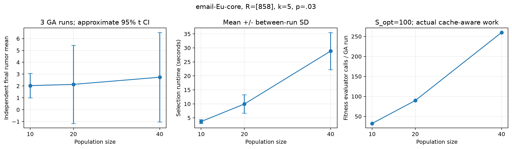
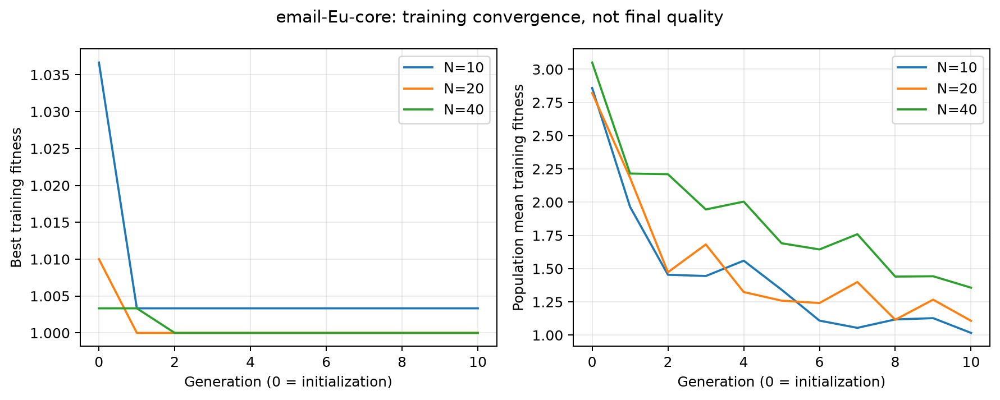
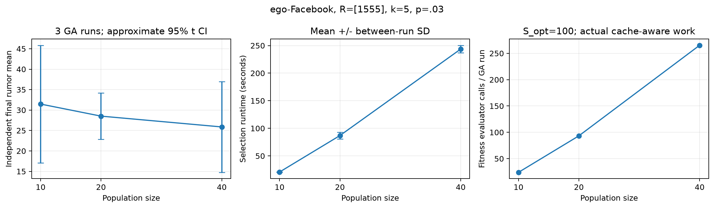
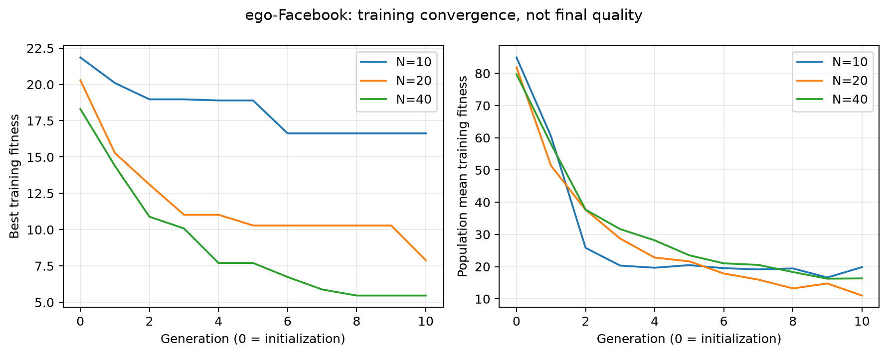
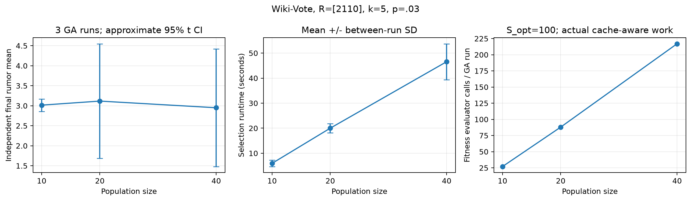
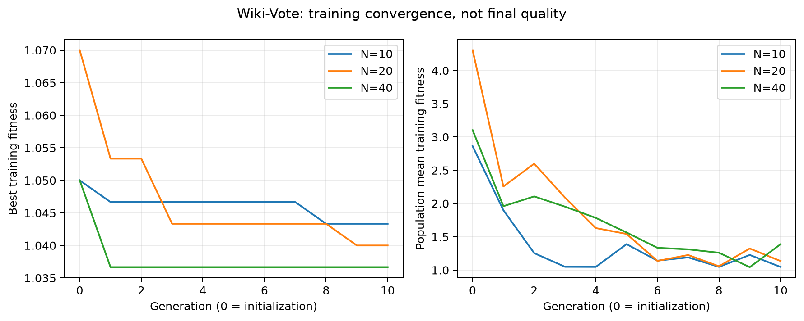

# Cross-Scenario GA Configuration Confirmation

**27/27 GA runs thành công**, 0 failed,
0 skipped; 0 failed/interrupted attempts.
Đây là kiểm tra ứng dụng của ba cấu hình đã định trước, không mở rộng parameter
search, không chạy Main Experiments và không chọn rumor seeds theo score thuật toán.

## 1. Thiết kế cố định trước execution

Reference đọc nguyên `reference_ga` của Protocol v1: N10/G10, crossover0.8,
mutation0.1, tournament3, elitism1, cache=True. Hai alternatives chỉ đổi N20/N40.
3 datasets ×3 profiles ×3 independent repetitions=27 GA runs; 9 runs/dataset.
Giữ k=5, p=.03, protector-priority và S_opt=100. Email dùng S_eval=6.000/batch,
Facebook/Wiki 2.500/batch, **B=2**; pooled final S=12.000/5.000 mỗi P.

Mọi cấu hình giữ cùng graph/R/k/p/tie/S trong scenario, không thay profile sau
khi xem kết quả. Order N được counterbalance theo repetition. Giữ API/semantics
IC/CIC/MC/GA/baseline; dùng lại chính V2 worker và `evaluate_cic()` cũ. Khóa P
của mỗi run trước independent final evaluation; kết quả final không quay về GA.
Cache/elite giữ nguyên chính sách fixed fitness schedule, cache cục bộ mỗi call.

## 2. Scenarios và phân chia dữ liệu

Chọn nguyên algorithm-outcome-validation scenarios của Protocol v1, được lấy
mẫu đều actual IDs trong reachability strata Pilot 2. Việc chọn không dùng
GA/baseline quality, không thay R vì control nhỏ. Reachable gồm source và tuân
theo hướng cạnh.
Ở đây "đại diện" là một source trong topology stratum đã lấy mẫu trước,
không phải khẳng định nó đại diện phân bố stochastic spread của cả dataset.

| Dataset | R confirmation | Reachable | Stratum | Prior Pilot2 p=.03 No Intervention mean/S200 | Prior no-growth fraction |
|---|---|---:|---|---:|---:|
| email-Eu-core | [858] | 966 | high | 5.560 | 96.0% |
| ego-Facebook | [1555] | 4.039 | constant | 175.555 | 36.5% |
| Wiki-Vote | [2110] | 2.317 | high | 5.015 | 89.5% |

Đây là các R đã có No Intervention scan trong calibration, nhưng chưa dùng
GA outcomes cho Pilot2/v1/V2 parameter screening. Confirmation hiện tại tiêu
thụ chúng cho đánh giá cấu hình: **không tiếp tục gọi chúng là blind holdouts
cho main**. Không ghi đè vai trò lịch sử trong frozen Protocol-v1 JSON.

Development R926/1180/1210 đã dùng trong algorithm calibration trước đây;
R926 còn dùng cho Reduced Screen V2. R858 và R2110 có potential reachability
cao nhưng stochastic spread nhỏ tại p=.03. Điều này gây floor/no-growth và
hạn chế khả năng phân biệt N; không diễn giải việc CI rộng thành equivalence.
R1555 cùng connected graph Facebook nhưng kết quả vẫn chỉ đại diện một source.
Low/legacy scenarios vẫn được giữ trong manifest, không tự loại khỏi kế hoạch
phân tích bổ sung. `scenario_usage.csv/json` ghi usage/confirmation counts.
Protocol Validation trước Pilot2 còn dùng email R577/Facebook R2162/Wiki
R4341; reserved main R mới cũng được audit không trùng các R này hoặc email
R0 của các smoke cũ (`main_holdout_prior_usage_audit.json`).

## 3. Seed policy và bảo vệ Main Experiments

Confirmation master=2026111111, khác V2=2026111110, pilot v1=2026111107
và reserved main=2026111109. Width=1.000.000, dùng
Cantor block/phase SHA256 của runner hiện có. Mỗi profile/repetition có opt index
=(scenario_index+1)*10000+profile_ordinal*100+repeat, cho 27 optimizer/fitness
schedules riêng. Fitness là base+i với i=0..99 trong từng GA, không đổi theo gen.
Final index=scenario_index*100+repeat, nửa final của block; batch b bắt đầu
final_base+b*S_eval. Cùng final seeds giữa N trong một scenario/repetition,
khác repetitions và không giao bất cứ opt interval nào. Cùng seed labels không
bảo đảm identical random edge outcomes khi valid attempts thay đổi theo P.

Reserved main R được lấy mẫu **topology-only**, uniform trong high/constant
theo rule Pilot 2, loại mọi R trong frozen manifest. Không đọc score GA/control
để chọn các R này và chưa chạy No Intervention hoặc thuật toán trên chúng.

| Dataset | R đề xuất giữ riêng | Stratum | Reachable | Sampling seed | Diffusion observations |
|---|---|---|---:|---:|---:|
| email-Eu-core | [485] | high | 965 | 16152107999921512756 | 0 |
| email-Eu-core | [374] | high | 965 | 16152107999921512756 | 0 |
| ego-Facebook | [714] | constant | 4039 | 4690500747993351643 | 0 |
| ego-Facebook | [2733] | constant | 4039 | 4690500747993351643 | 0 |
| Wiki-Vote | [1961] | high | 2316 | 2588087911114568307 | 0 |
| Wiki-Vote | [1795] | high | 2317 | 2588087911114568307 | 0 |

Sampling master=2026111112. Các R mới có ordinal
11..16 trong derived reservation, không sửa frozen manifest gốc. Giữ main master
2026111109, preallocate 10 slots/scenario (`index=scenario_index*100+repeat`),
tổng60 **reserved slots, không phải 60 main runs đã được chốt/chạy**. Main repeats
còn cần xác nhận. Các block labels trong reserved_main_schedule.json/csv;
explicit opt/final intervals và hai batch bases trong reserved_main_seed_intervals.json/csv;
reserved_main_scenarios.json ghi rule/excluded IDs/reachable. V2/confirmation
observations không là bằng chứng cuối cùng cho main. Giữ primary/supplementary
role thay vì xem high-stratum sample như uniform toàn bộ V.

## 4. Computational preflight và chi phí thực đo

Bound calls/run U=N+G(N−E): 100/210/430 ứng với N10/20/40. Mỗi dataset có
3×(100+210+430)=2.220 fitness calls, S_opt100. Shared No Intervention một lần
cho scenario/repeat/batch, không lặp cho từng N.

| Phase | Evaluator calls upper | CIC simulations upper |
|---|---:|---:|
| Fitness | 6.660 | 666.000 |
| Independent GA final | 54 | 198.000 |
| Shared control | 18 | 66.000 |
| Tổng | 6.732 | 930.000 |

Pilot2 rate projection trước safety=4039.925 s;
nhân safety1.5=6059.888 s; cộng loading/
setup/export allowance300 s thành **6359.888 s**,
dưới cap10.800 s. Counts dưới cap120GA/3.000.000CIC. Đây là **ngoại suy từ R
khác**, không phải measured runtime hoặc hard upper bound. R mới/P khác có
thể đổi tốc độ; engine dừng nếu cumulative time/CIC vượt cap, không tự giảm S.

Memory probes chỉ load graph+deepcopy, 0 diffusion calls. Projected RSS=
2×max probe+256MiB=578.8 MiB.
Giới hạn worker=2.0 GiB, concurrency=1;
peak worker đo thực=177.8 MiB. Watchdog dùng
resource.ru_maxrss/heartbeat bên trong worker, parent đọc heartbeat và timeout;
không cần quyền process listing. Sampling interval0.5s không là instantaneous
hard memory ceiling; short spikes vẫn được ghi trong peak RSS, phát hiện ở
lần check tiếp theo. Giới hạn là RSS, không phải virtual address space.

**Actual 3362 evaluator calls, 593,000 CIC**:
fitness=3290 calls/329,000 CIC;
final=54 calls/198,000 CIC;
control=18 calls/66,000 CIC.
Cache hits=3370; elite carries=270.

| Dataset | GA runs | Total calls | Total CIC | Selection s | GA final s | Peak worker MiB |
|---|---:|---:|---:|---:|---:|---:|
| email-Eu-core | 9 | 1170 | 258600 | 127.527 | 116.407 | 124.2 |
| ego-Facebook | 9 | 1172 | 174800 | 1054.059 | 443.793 | 160.3 |
| Wiki-Vote | 9 | 1020 | 159600 | 217.611 | 102.678 | 177.8 |

Tổng active execution=2163.027 s: selection
1399.197 s (fitness MC
1389.678 s **đã nằm trong selection**),
GA final 662.878 s, control
63.198 s, loading
3.821 s; còn lại imports/guard/JSON/bookkeeping.
Analysis/plot/tests tách khỏi algorithm runtime. Checkpoint atomic từng unit,
resume xác minh fingerprint/hashes rồi bỏ qua units đã lưu; cumulative caps
không reset. Unknown partial work bị charge upper CIC/timeout thay vì ghi0.

## 5. Kết quả theo từng dataset

SD/CI qua GA runs bao gồm biến động GA và MC error. Conditional MC SE/CI của
P cố định được lưu từng batch và pooled; không nhầm std CIC với SE của mean.
Training–final gaps ghi riêng; không chọn cấu hình bằng training fitness.
Các CI t(df=2) qua ba runs có độ bất định rất lớn, nhất là rare large cascades.

### email-Eu-core, R=[858]

Reachable=966, stratum=high. Mỗi N
có đúng 3 independent GA runs; không dùng các MC observations như GA repeats.

| N | Training mean | Final mean | SD giữa GA means | CI95 qua GA runs | Mean conditional MC SE | Selection s/run | Final s/run | Fitness calls/run | Cache hits/run |
|---|---:|---:|---:|---|---:|---:|---:|---:|---:|
| 10 | 1.003 | 2.034 | 0.411 | [1.013, 3.054] | 0.109 | 3.69 | 14.57 | 32.3 | 67.7 |
| 20 | 1.000 | 2.137 | 1.327 | [-1.160, 5.433] | 0.107 | 9.93 | 12.60 | 89.7 | 120.3 |
| 40 | 1.000 | 2.741 | 1.521 | [-1.039, 6.520] | 0.148 | 28.89 | 11.63 | 260.0 | 170.0 |

Delta=alternative−reference, số âm là ít rumor hơn; chỉ so trong scenario này.

| N | Delta | Pointwise CI95 (3 pairs) | Family CI95 (Bonferroni, 6 contrasts) | Diễn giải |
|---|---:|---|---|---|
| 20 | +0.103 | [-2.440, +2.646] | [-6.331, +6.537] | insufficient_evidence_of_difference |
| 40 | +0.707 | [-2.505, +3.919] | [-7.420, +8.834] | insufficient_evidence_of_difference |

Training fitness gần floor1 trong cả ba cấu hình; final means không bằng training fitness. Source có 96% no-growth trong Pilot2, nên panel này kiểm tra được khả năng chạy trên R mới nhưng yếu để phân biệt population. Mean N40 lớn hơn N10 trong sample này không đủ chứng minh N40 kém hơn.




### ego-Facebook, R=[1555]

Reachable=4039, stratum=constant. Mỗi N
có đúng 3 independent GA runs; không dùng các MC observations như GA repeats.

| N | Training mean | Final mean | SD giữa GA means | CI95 qua GA runs | Mean conditional MC SE | Selection s/run | Final s/run | Fitness calls/run | Cache hits/run |
|---|---:|---:|---:|---|---:|---:|---:|---:|---:|
| 10 | 16.630 | 31.468 | 5.792 | [17.081, 45.854] | 1.458 | 20.78 | 48.80 | 24.0 | 76.0 |
| 20 | 7.893 | 28.519 | 2.279 | [22.857, 34.180] | 1.318 | 86.92 | 52.10 | 93.3 | 116.7 |
| 40 | 5.463 | 25.873 | 4.472 | [14.765, 36.981] | 1.265 | 243.66 | 47.02 | 265.3 | 164.7 |

Delta=alternative−reference, số âm là ít rumor hơn; chỉ so trong scenario này.

| N | Delta | Pointwise CI95 (3 pairs) | Family CI95 (Bonferroni, 6 contrasts) | Diễn giải |
|---|---:|---|---|---|
| 20 | -2.949 | [-22.464, +16.566] | [-52.323, +46.425] | insufficient_evidence_of_difference |
| 40 | -5.595 | [-17.337, +6.148] | [-35.304, +24.115] | insufficient_evidence_of_difference |

Mean final giảm mô tả khi tăng N, nhưng hai contrast CIs còn chứa0. N40 tốn 11.73 lần selection time của N10. Training–final gaps vẫn lớn và tăng search effort không tự chứng minh lợi ích đủ chắc chắn để thay reference.




### Wiki-Vote, R=[2110]

Reachable=2317, stratum=high. Mỗi N
có đúng 3 independent GA runs; không dùng các MC observations như GA repeats.

| N | Training mean | Final mean | SD giữa GA means | CI95 qua GA runs | Mean conditional MC SE | Selection s/run | Final s/run | Fitness calls/run | Cache hits/run |
|---|---:|---:|---:|---|---:|---:|---:|---:|---:|
| 10 | 1.043 | 3.016 | 0.062 | [2.860, 3.171] | 0.379 | 5.96 | 11.04 | 27.0 | 73.0 |
| 20 | 1.040 | 3.117 | 0.577 | [1.683, 4.550] | 0.378 | 20.01 | 11.43 | 88.0 | 122.0 |
| 40 | 1.037 | 2.950 | 0.591 | [1.481, 4.419] | 0.370 | 46.57 | 11.75 | 217.0 | 213.0 |

Delta=alternative−reference, số âm là ít rumor hơn; chỉ so trong scenario này.

| N | Delta | Pointwise CI95 (3 pairs) | Family CI95 (Bonferroni, 6 contrasts) | Diễn giải |
|---|---:|---|---|---|
| 20 | +0.101 | [-1.273, +1.475] | [-3.376, +3.578] | insufficient_evidence_of_difference |
| 40 | -0.066 | [-1.629, +1.498] | [-4.021, +3.890] | insufficient_evidence_of_difference |

Final means còn gần nhau trong khi conditional MC SE đáng kể. Raw GA variance component âm ở N=[10]; giữ nguyên giá trị âm thay vì xem nó là bằng chứng GA ổn định tuyệt đối. CI qua chỉ ba run means có thể hẹp do ngẫu nhiên, không thay thế MC diagnostics hoặc chứng minh equivalence.





## 6. Diễn giải bất định và quyết định cấu hình

Decision machine-readable: **retain_reference_as_practical_candidate**;
0/6 contrasts có family CI loại0.
Chỉ so N20−N10 và N40−N10 trong cùng scenario. Pointwise95% và approximate
Bonferroni family95% cho sáu planned contrasts đều được lưu. Correction không
gộp effect sizes/rumor counts giữa datasets. **CI chứa0 nghĩa là chưa đủ bằng
chứng khác biệt, không chứng minh tương đương**; chưa có equivalence margin,
power analysis hoặc global optimum claim.

Variance-components giữ Var(run means), mean(MC SE²), raw difference kể cả
âm; display clipped>=0 riêng. Với contrasts, MC SE dùng seed-aligned raw
differences. n=3 không cho phép decomposition ổn định hoặc chứng minh cấu
hình tổng quát. Các training curves là diagnostic, không là final quality.

Đề xuất cấu hình cần khóa nếu người dùng xác nhận protocol main: **reference
N10/G10/crossover0.8/mutation0.1/tournament3/elitism1/cache=True**, giữ
k5/p.03/protector-priority/S_opt100 và S_eval/B v1. Khi decision yêu cầu review,
chưa nên khóa main trước khi xem các contrasts và giới hạn tương ứng. Giữ
reference là lựa chọn đã định trước có chi phí thấp, không phải tuyên bố nó
vượt alternatives hay tương đương chúng. Không tự cập nhật frozen v1 hoặc
chọn N20/N40 chỉ từ một scenario; không tiếp tục search tham số trong stage này.

Khả năng khái quát còn giới hạn: một R mỗi graph; only high/constant strata;
email/Wiki control ít spread; ba GA repeats; fixed S_opt100 fitness noise và
selection bias; p/k cố định; N tăng đồng thời tăng search/evaluation effort.
Các R main mới chưa có outcome nên chưa biết mức spread/precision; cần chốt
main protocol và preflight riêng, không xem kết quả main rồi quay lại tuning.
`main_configuration_proposal.json` là proposal, main repeats và scenario/p
grid chưa tự chốt chỉ vì đã reserve seed slots.

## 7. Kiểm chứng và artifacts

**443/443 tests pass**; 44 existing protected files, trong đó 14 data files, giữ nguyên checksum.
Raw/processed topology, IC/CIC/Monte Carlo/GA/Greedy/baseline và frozen v1 không
đổi. Prior Pilot2/v1/V2 artifacts được kiểm tra độc lập. Mọi thống kê final,
population invariants/elite carries/counters được audit lại từ checkpoint.
Không chạy Main Experiments/Full Design. Không tái sử dụng observations hiện
tại làm official main evidence.

[matrix.csv](docs/cross_scenario_ga_confirmation/matrix.csv),
[run_results.csv](docs/cross_scenario_ga_confirmation/run_results.csv),
[summary_by_dataset_configuration.csv](docs/cross_scenario_ga_confirmation/summary_by_dataset_configuration.csv),
[contrasts.csv](docs/cross_scenario_ga_confirmation/contrasts.csv),
[convergence.csv](docs/cross_scenario_ga_confirmation/convergence.csv),
[main_configuration_proposal.json](docs/cross_scenario_ga_confirmation/main_configuration_proposal.json).
Per-run JSON/history ở docs/cross_scenario_ga_confirmation/runs; raw counts/
complete GA payloads/checkpoints ở results/cross_scenario_ga_confirmation
(gitignored), có raw inventory/hashes và metadata Python/libs/OS/hardware/Git.

```sh
.venv/bin/python -B -m experiments.cross_scenario_ga_confirmation --phase preflight
.venv/bin/python -B -u -m experiments.cross_scenario_ga_confirmation --phase run
.venv/bin/python -B -m experiments.analyze_cross_scenario_confirmation
.venv/bin/python -B -m unittest discover -s tests -q
```
