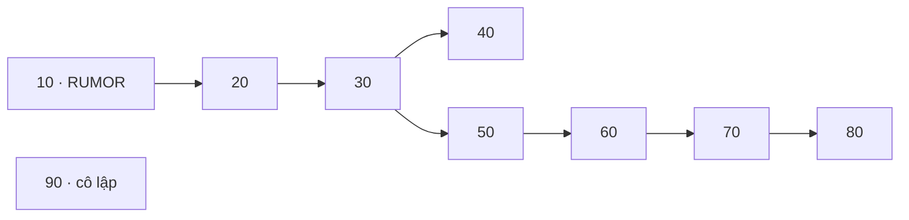

# Hướng dẫn cấu hình và chạy thủ công một kịch bản nhỏ

Tài liệu này giúp bạn tự tạo đồ thị nhỏ, chỉnh JSON, chạy các thuật toán bằng
Terminal và đọc kết quả. Ví dụ dùng đúng IC/CIC, Monte Carlo và các thuật toán
đang có trong repository. Đây là bài thực hành trên đồ thị tổng hợp; các tham
số nhỏ bên dưới dùng để học cách chạy và kiểm tra chương trình.

File cấu hình có sẵn:
[experiments/configs/manual_small_scenario.json](experiments/configs/manual_small_scenario.json).
Đầu vào và đầu ra của bài thực hành nằm trong `results/`, tách khỏi ba bộ dữ
liệu SNAP và kết quả Main Experiments đã khóa.

## 1. Mở đúng môi trường

Trong VS Code, mở Terminal tại thư mục gốc `misinformation-blocking-ga`, nơi
có `main.py`, `requirements.txt` và thư mục `src/`. Chạy:

```sh
pwd
.venv/bin/python --version
.venv/bin/python -c 'import networkx; print("NetworkX:", networkx.__version__)'
```

Các lệnh trong hướng dẫn gọi thẳng Python của `.venv`, vì vậy bạn có thể dùng
chúng mà không cần kích hoạt môi trường. Dùng `.venv` hiện có của dự án.
Nếu Terminal báo không tìm thấy `.venv/bin/python`, kiểm tra lại thư mục đang
mở và vị trí môi trường trước khi chạy tiếp.

## 2. Tạo đồ thị 9 nút

Đồ thị có hướng, gồm các ID không liên tục `10, 20, ..., 90`. Nút `90` cô lập.
Rumor bắt đầu tại `R=[10]`; thuật toán cần chọn một protector node (`k=1`).



Copy toàn bộ khối sau vào Terminal, gồm cả dòng `PY` cuối cùng:

```sh
.venv/bin/python -B - <<'PY'
from dataclasses import asdict
from pathlib import Path

import networkx as nx

from src.data import graph_statistics, load_processed_graph
from src.data.storage import save_processed_graph

graph = nx.DiGraph()
graph.add_nodes_from(range(10, 100, 10))
graph.add_edges_from([
    (10, 20), (20, 30), (30, 40), (30, 50),
    (50, 60), (60, 70), (70, 80),
])
directory = Path("results/manual_demo_input")
metadata = {
    "schema_version": 1,
    "dataset": "manual-nine-node",
    "directed": True,
    "purpose": "synthetic_manual_learning_example",
    "processed_statistics": asdict(graph_statistics(graph)),
}

if directory.exists():
    loaded = load_processed_graph(directory)
    if not nx.utils.graphs_equal(graph, loaded):
        raise ValueError("Thư mục đầu vào đã chứa đồ thị khác; chọn đường dẫn mới.")
else:
    save_processed_graph(graph, metadata, directory)

print("Input:", directory.resolve())
print("Statistics:", asdict(graph_statistics(load_processed_graph(directory))))
PY
```

Kết quả cần có: **9 nodes, 7 edges, 0 self-loops, 1 isolated node**. Ba file
`nodes.csv`, `edges.csv`, `metadata.json` được tạo trong
`results/manual_demo_input/`. Tên dataset là `manual-nine-node` để thể hiện
đúng nguồn dữ liệu tổng hợp.

## 3. Hiểu và chỉnh cấu hình

Mở `experiments/configs/manual_small_scenario.json` trong VS Code. File này
đã chứa đầy đủ các trường cần thiết; bạn có thể chạy nguyên bản trước.

| Trường | Giá trị ví dụ | Ý nghĩa |
|---|---|---|
| `dataset` | `manual-nine-node` | Nhãn phải khớp `dataset` trong metadata đầu vào. |
| `processed_directory` | `../../results/manual_demo_input` | Nơi đọc đồ thị đã lưu. |
| `rumor_seeds` | `[10]` | ID các nguồn rumor, phải tồn tại trong đồ thị. |
| `k` | `1` | Số protector nodes của mỗi phương pháp can thiệp. |
| `p` | `0.5` | Xác suất thành công của mỗi activation attempt hợp lệ, áp dụng cho cả hai cascade. |
| `tie_breaking` | `protector-priority` | Protector thắng khi hai cascade cùng kích hoạt thành công một nút trong cùng timestep. |
| `S_opt` | `20` | Số CIC simulations cho mỗi phép đánh giá fitness trong GA/Greedy. |
| `S_eval` | `200` | Số CIC simulations đánh giá độc lập mỗi tập P đã chọn. |
| `random_seed` | `2026111201` | Master seed để runner sinh các lịch random có thể tái lập. |
| `independent_run_index` | `0` | Chỉ số lần chạy độc lập, bắt đầu từ 0. |
| `seed_block_size` | `1000000` | Độ rộng block seed; giữ nguyên khi thực hành. |
| `output_directory` | `../../results/manual_small_scenario` | Thư mục gốc để lưu kết quả. |
| `save_raw_observations` | `true` | Lưu từng observation của final Monte Carlo vào CSV. |

`rumor_seeds` là **ID nút**, còn `random_seed` là **seed của bộ sinh số ngẫu
nhiên**. Ví dụ `random_seed=2026111201` không yêu cầu đồ thị có nút đó.

Đường dẫn tương đối trong JSON được tính từ **thư mục chứa file JSON**.
Với file nằm trong `experiments/configs/`, `../../results/...` trỏ tới
`results/...` ở gốc repository. Các lệnh Terminal được chạy từ gốc repository.

JSON dùng `true`/`false` viết thường, không có comment và không có dấu phẩy
thừa sau phần tử cuối. Nếu tạo bản sao cấu hình để thực hành, hãy giữ bản sao
trong `experiments/configs/` để các đường dẫn tương đối vẫn đúng.

### Các tham số GA

| Trường trong `ga_parameters` | Giá trị | Tác dụng |
|---|---:|---|
| `population_size` | 6 | Số cá thể trong mỗi quần thể. |
| `max_generations` | 4 | Chạy 4 thế hệ sau quần thể khởi tạo; convergence có generation 0 đến 4. |
| `crossover_rate` | 0.8 | Xác suất áp dụng Set Crossover. |
| `mutation_rate` | 0.1 | Xác suất mutation thay thế một nút hợp lệ. |
| `tournament_size` | 3 | Số cá thể tham gia mỗi tournament. |
| `elitism_count` | 1 | Số elite được giữ qua thế hệ kế tiếp. |
| `cache_fitness` | `true` | Tái sử dụng fitness của cùng tập P trong lần tối ưu với cùng lịch MC. |

GA tối thiểu hóa mean rumor count. Tăng population/generations làm tăng số
lượt yêu cầu fitness; tăng `S_opt` làm mỗi lượt fitness tốn thêm CIC simulations.
Các giá trị ở đây chỉ giúp bài thực hành chạy nhẹ; cấu hình GA tham chiếu của
Main vẫn được giữ trong protocol riêng.

### Chọn phương pháp và giới hạn chi phí

`algorithms` trong ví dụ chứa đủ bảy tên:

```json
[
  "no_intervention", "random", "degree", "pagerank",
  "full_greedy", "candidate_restricted_greedy", "genetic_algorithm"
]
```

No Intervention dùng `P=[]` làm mốc. Các phương pháp còn lại chọn đúng `k`
nút ngoài R. Degree xếp theo out-degree trên đồ thị có hướng, theo degree
trên đồ thị vô hướng; điểm bằng nhau được xử lý xác định theo ID nút.

`candidate_restriction={"method":"degree","size":4}` giới hạn Restricted
Greedy vào 4 nút hợp lệ đứng đầu theo degree/out-degree. Đây là phương pháp
riêng với Full Greedy. Với ví dụ này pool là `[30,20,50,60]` theo thứ tự xếp
hạng; khi lưu tập, thứ tự ID có thể được chuẩn hóa.

Nếu chỉ muốn học GA, có thể đổi `algorithms` thành `["genetic_algorithm"]`;
runner tự thêm No Intervention làm mốc. Số dòng kết quả khi đó là 2.

Các `limits` chặn công việc **trước khi tối ưu**, kiểm tra riêng từng optimizer:

- `max_optimization_evaluations=30`: tối đa 30 evaluator calls theo upper bound.
- `max_optimization_cic_simulations=600`: tối đa 600 CIC trong tối ưu.
- `max_full_greedy_evaluations=10` và `max_full_greedy_cic_simulations=200`:
  thêm giới hạn dành riêng cho Full Greedy.

Các giới hạn này đếm công việc tối ưu; final evaluation có chi phí riêng.
Runner nhỏ không đặt timeout/RAM cap hoặc checkpoint/resume từng batch như
runner Main. Nếu một phương pháp được yêu cầu vượt giới hạn, lệnh báo lỗi;
muốn bỏ phương pháp đó, sửa danh sách `algorithms` và ghi lý do trong
`skipped_algorithms`.

## 4. Kiểm tra cấu hình và preflight

Chạy đoạn sau để kiểm tra JSON, seed IDs và chi phí mà chưa chạy Monte Carlo:

```sh
.venv/bin/python -B - <<'PY'
import json
from src.data import load_processed_graph
from src.experiments import load_experiment_config
from src.experiments.runner import preflight, resolve_rumor
from src.experiments.seeds import make_experiment_seed_plan

config = load_experiment_config("experiments/configs/manual_small_scenario.json")
c = config.to_dict()
graph = load_processed_graph(c["processed_directory"])
seeds = make_experiment_seed_plan(
    c["random_seed"], c["independent_run_index"], c["seed_block_size"]
)
rumor = resolve_rumor(graph, c, seeds)
cost = preflight(graph, rumor, c)
print(json.dumps(cost, indent=2))
print("R:", rumor)
print("Output sẽ tạo:", config.run_directory)
print("Optimization base seed:", seeds.optimization_base_random_seed)
print("Final base seed:", seeds.final_base_random_seed)
PY
```

Với cấu hình nguyên bản, có 8 nút ứng viên và `k=1`:

| Thành phần | Evaluator calls upper bound | CIC simulations upper bound |
|---|---:|---:|
| Full Greedy | 8 | 160 |
| Restricted Greedy, pool 4 | 4 | 80 |
| GA có cache | 8 | 160 |
| Random/Degree/PageRank/NI: chọn P | 0 | 0 |
| Final evaluation của 7 methods | 7 | 1.400 |
| **Tổng** | **27** | **1.800** |

GA chưa tính cache có upper bound `N + G*(N-elitism) = 6 + 4*5 = 26`.
Do `k=1` trên 8 candidates, chỉ có 8 tập P khác nhau; cache làm upper bound
còn `min(26,8)=8`. Số thực tế có thể thấp hơn nếu GA chưa thăm đủ 8 tập.
Preflight là ước lượng số lượt, không phải runtime đã đo.

## 5. Chạy một lần bằng Terminal

```sh
.venv/bin/python -B main.py experiment --config experiments/configs/manual_small_scenario.json
```

Chờ lệnh trả về Terminal. Khi thành công, chương trình in:

```text
Saved experiment: .../results/manual_small_scenario/manual-nine-node/run_0000_<hash>/
Methods: 7; CIC simulations: <số thực tế>
Total runtime: <giây đã đo>s
```

`<hash>` và các phần trong dấu `<...>` là chỗ chương trình tự điền; bạn không
nhập chúng vào lệnh. Với cấu hình `k=1`, có 7 final evaluator calls; No
Intervention được tính một lần. Final dùng seed block riêng sau khi mọi
phương pháp đã chốt P. Ví dụ này dùng **một final batch với S_eval=200** cho
mỗi P; quy trình Main hai batch được lưu trong runner/protocol Main riêng.

## 6. Mở và đọc kết quả

Thư mục run chứa:

```text
config.json             Cấu hình đã chuẩn hóa, gồm đường dẫn đã resolve
preflight.json          Upper bound trước khi tối ưu
results.csv             Một dòng cho mỗi phương pháp
method_status.csv       Completed/skipped và lý do
summary.json            Thống kê và tổng evaluator/CIC counts
metadata.json           Seed plan, môi trường, checksum, runtime breakdown
selection_details.json  Chi tiết GA/Greedy và các tập P
convergence.csv         Lịch sử GA generation 0..4
raw_observations.csv    Từng observation MC cuối, có random seed
```

`results.csv` là bảng kết quả; `summary.json` chứa kết quả dạng JSON.
Runner này xuất CSV cùng summary JSON, không tạo file `results.json` riêng.

Chạy đoạn sau để in bảng mà không cần tìm `<hash>` bằng tay:

```sh
.venv/bin/python -B - <<'PY'
import json
import pandas as pd
from src.experiments import load_experiment_config

config = load_experiment_config("experiments/configs/manual_small_scenario.json")
directory = config.run_directory
table = pd.read_csv(directory / "results.csv")
columns = [
    "algorithm", "protector_seeds", "rumor_mean", "rumor_std_sample",
    "rumor_standard_error", "rumor_reduction_percent",
    "selection_runtime_seconds", "final_evaluation_runtime_seconds",
]
print("Run directory:", directory)
print(table[columns].to_string(index=False))
summary = json.loads((directory / "summary.json").read_text())
print("Optimization evaluator calls:", summary["total_optimization_evaluations"])
print("Final evaluator calls:", summary["total_final_evaluations"])
print("Total CIC simulations:", summary["total_cic_simulations"])
print("\nGA convergence:")
history = pd.read_csv(directory / "convergence.csv")
print(history[["generation", "best_fitness", "mean_fitness"]].to_string(index=False))
PY
```

Những cột cần đọc trước:

| Cột | Cách hiểu |
|---|---|
| `protector_seeds` | Tập P đã được chọn. |
| `rumor_mean` | Mean rumor từ final evaluation độc lập; đây là metric chất lượng chính. |
| `rumor_std_sample` | Độ phân tán của rumor count giữa các CIC simulations cho P cố định. |
| `rumor_standard_error` | SE của mean MC, bằng sample SD chia căn `S_eval`. |
| `rumor_reduction_percent` | `100*(NI mean - method mean)/NI mean`; giá trị âm được giữ nguyên. |
| `optimization_best_estimated_fitness` | Training fitness đã dùng trong tìm kiếm; đọc để debug/hội tụ. |
| `selection_runtime_seconds` | Thời gian chọn P, gồm MC tối ưu nếu có. |
| `final_evaluation_runtime_seconds` | Thời gian MC cuối cho P đã chốt. |

Tổng runtime và thời gian nạp graph nằm trong `metadata.json`/`summary.json`.
Một run trên đồ thị nhỏ giúp kiểm tra cách vận hành. Mean nhỏ nhất ở lần chạy
này chưa đủ để kết luận thuật toán tốt nhất; MC uncertainty và biến động giữa
các lần chạy GA là hai nguồn biến động khác nhau.

## 7. Kiểm tra kết quả bằng tay

Để nhìn rõ quy tắc lan truyền, dùng `p=1` và chọn P trực tiếp qua CIC:

```sh
.venv/bin/python -B - <<'PY'
from src.data import load_processed_graph
from src.diffusion import simulate_cic

graph = load_processed_graph("results/manual_demo_input")
cases = [
    (1.0, [], 8, 0, 1),
    (1.0, [20], 1, 7, 1),
    (1.0, [30], 2, 6, 1),
    (1.0, [90], 8, 1, 0),
    (0.0, [20], 1, 1, 7),
]
for p, protector, expected_r, expected_p, expected_i in cases:
    result = simulate_cic(
        graph, [10], protector, p,
        random_seed=12345, tie_breaking="protector-priority",
    )
    counts = (result.rumor_count, result.protector_count, result.inactive_count)
    assert counts == (expected_r, expected_p, expected_i)
    print(f"p={p}, P={protector}: rumor/protector/inactive={counts}")
print("Cả 5 trường hợp đúng với phép kiểm tra bằng tay.")
PY
```

| p | P | Rumor cuối | Protector cuối | Inactive cuối |
|---:|---|---:|---:|---:|
| 1 | `[]` | 8 | 0 | 1 |
| 1 | `[20]` | 1 | 7 | 1 |
| 1 | `[30]` | 2 | 6 | 1 |
| 1 | `[90]` | 8 | 1 | 0 |
| 0 | `[20]` | 1 | 1 | 7 |

Ví dụ P=[20] chặn ngay sau nguồn 10, nên rumor chỉ còn nút 10. P=[90] đặt bảo
vệ ở nút cô lập, nên không chặn đường lan truyền của rumor. Đây là các giá
trị xác định của bài toán, không phụ thuộc kết quả chọn P của GA.

## 8. Chạy lại, đổi tham số và kiểm tra tái lập

**Giữ cấu hình và run index để tái lập:** chạy vào output root mới:

```sh
.venv/bin/python -B -m experiments.run_experiment --config experiments/configs/manual_small_scenario.json --output-dir results/manual_repeat_check
```

Tập P, seed schedule, training fitness và các MC observations phải tái lập
với cùng code/môi trường/graph/tham số. Runtime có thể khác. Vì lệnh này
override output root, mở kết quả tại đường dẫn `Saved experiment` vừa in.

**Đổi run index để có lần chạy độc lập:**

```sh
.venv/bin/python -B -m experiments.run_experiment --config experiments/configs/manual_small_scenario.json --run-index 1
.venv/bin/python -B -m experiments.run_experiment --config experiments/configs/manual_small_scenario.json --run-index 2
```

Hai lệnh giữ nguyên R=[10] nhưng đổi lịch random. Mỗi lệnh tạo một run directory
riêng. Nếu muốn đọc run 1 bằng Python, lấy `config.to_dict()`, sửa
`independent_run_index=1`, rồi tạo `ExperimentConfig.from_dict(...)` trước khi
đọc `run_directory`; script đọc ở mục 6 mặc định đọc run index trong JSON.

**Muốn khảo sát một tham số:** tạo bản sao JSON cùng thư mục, thay đúng trường
cần khảo sát, giữ R/k/p và các điều kiện còn lại khi so sánh một tham số GA.
Ví dụ population 6→8, giữ generations/crossover/mutation. Dùng cùng các run
indices giữa hai cấu hình và final schedule thống nhất. Kiểm tra lại preflight
khi đổi N, G, k hoặc S_opt. Đây là thực hành riêng, giữ nguyên cấu hình Main.

Runner từ chối ghi đè một run directory đã có. Đổi `output_directory` để chạy
lại cùng phép thử, hoặc đổi `independent_run_index` để có lịch random mới.
Runner nhỏ thực thi trọn một run; nếu bị ngắt, dùng output root mới khi chạy
lại. Các run đã hoàn tất vẫn được giữ nguyên.

## 9. Thử chuyển sang email-Eu-core

Sau khi chạy được đồ thị nhỏ, copy JSON thành
`experiments/configs/manual_email_local.json` rồi chỉnh:

```json
{
  "dataset": "email-Eu-core",
  "processed_directory": "../../data/processed/email-Eu-core",
  "rumor_seeds": [0],
  "k": 1,
  "p": 0.03,
  "random_seed": 2026111202,
  "output_directory": "../../results/manual_email_local"
}
```

Khối trên liệt kê **những trường cần thay trong bản sao đầy đủ**, không phải
toàn bộ config. Giữ các trường còn lại, **xóa `"full_greedy"` khỏi algorithms**
và thêm trường ở cấp ngoài cùng:

```json
"skipped_algorithms": {
  "full_greedy": "omitted_from_manual_email_demo_due_to_cost"
}
```

Với email, Full Greedy k=1 phải xét 1.004 candidates, tương ứng 20.080 CIC
trong tối ưu nếu S_opt=20; vượt giới hạn Full Greedy của bài thực hành.
Candidate-Restricted Greedy vẫn giữ tên và pool riêng. Kiểm tra preflight
theo mục 4 bằng đường dẫn JSON mới, rồi chạy:

```sh
.venv/bin/python -B main.py experiment --config experiments/configs/manual_email_local.json
```

Đây là một lần thử nhẹ với dữ liệu thật. Các tham số nhỏ ở bài thực hành
không thay thế thiết kế và đánh giá thống kê của Main Experiments.

## 10. Lỗi thường gặp

| Thông báo/hiện tượng | Cách xử lý |
|---|---|
| Không tìm thấy `.venv/bin/python` hoặc `main.py` | Mở Terminal ở gốc repository và kiểm tra `pwd`. |
| Không tìm thấy `metadata.json` | Chạy mục 2; kiểm tra `processed_directory` tính từ thư mục JSON. |
| `Dataset label does not match processed metadata` | Sửa nhãn dataset/đường dẫn cho khớp nguồn dữ liệu đang nạp. |
| `Rumor seeds do not exist in processed graph` | Chọn ID thực tế trong `nodes.csv`, không giả định ID liên tục. |
| `k exceeds eligible non-rumor node count` | Giữ k không vượt số nút ngoài R. |
| `Candidate pool smaller than k` | Tăng pool hoặc giảm k của bài thực hành. |
| `exceed optimization limits` / `Full Greedy blocked` | Đọc preflight; giảm công việc thử hoặc bỏ phương pháp tốn kém có ghi lý do. |
| `Experiment directory already exists` | Dùng output root mới hoặc run index mới; giữ kết quả cũ. |
| Đổi run index nhưng kết quả giống nhau | Có thể xảy ra với graph nhỏ, phương pháp xác định hoặc p=0/1; kiểm tra seed plan. |
| Mean thấp nhưng training/final khác nhau | Fitness dùng S_opt nhỏ và có selection bias; đọc final mean cùng uncertainty. |

Luồng thao tác: **tạo input → chỉnh JSON → preflight → chạy CLI → đọc results
và convergence → kiểm tra trường hợp tính tay → thử các run độc lập**.

## 11. Kết quả kiểm chứng của chính hướng dẫn này

Ngày 12/11/2026, đã chạy nguyên các lệnh từ mục 1 đến mục 7 với JSON mẫu,
run index 0, sau đó chạy lại cùng seed vào output root riêng. Các tập P,
training fitness và toàn bộ final raw observations tái lập. Năm trường hợp
tính tay đều đúng. Kết quả MC đã chạy thực tế:

| Phương pháp | P | Final rumor mean |
|---|---|---:|
| No Intervention | `[]` | 2.295 |
| Random | `[50]` | 1.920 |
| Degree | `[30]` | 1.540 |
| PageRank | `[80]` | 2.275 |
| Full Greedy | `[20]` | 1.000 |
| Candidate-Restricted Greedy | `[20]` | 1.000 |
| Genetic Algorithm | `[30]` | 1.540 |

Thực tế có **18 optimization evaluator calls + 7 final calls = 25 calls**,
tương ứng **1.760 CIC simulations**; thấp hơn upper bound 27 calls/1.800 CIC.
Một lần chạy đo được khoảng **0,186 giây** trong môi trường hiện tại, theo
phạm vi đo total runtime của runner; đây là số đo minh họa, thời gian có thể
thay đổi theo máy và trạng thái hệ thống.

Trong lần chạy ngắn này GA chọn `[30]`, training fitness 1.45, final mean 1.54.
GA chưa tìm được `[20]`, tập chặn rumor ngay sau nguồn. Quần thể và số thế hệ
nhỏ có thể bỏ sót lời giải tốt; kết quả này được giữ nguyên để minh họa cách
đọc dữ liệu thực tế. Các con số trong bảng là ví dụ học cách chạy chương trình.

Các output kiểm chứng được chuyển vào thư mục riêng trong
`results/manual_documentation_checks/`; output root mặc định của mục 5 được
để sẵn cho bạn tự chạy. Dữ liệu SNAP, các lõi và artifact Main giữ nguyên.
