# Main Experiments Results — Frozen Protocol V2

**completed**: 144/144 primary result rows completed,
0 failed,0 primary skipped; thêm
**24 Full Greedy rows skipped** theo cost limits.
Failed/interrupted physical attempts=0.
Đã hoàn tất đúng ma trận được xác nhận.
Không thêm experiments ngoài matrix, không retune GA/R/S từ main outcomes.

## 1. Frozen setup, data and execution

[Protocol V2](MAIN_EXPERIMENTS_PROTOCOL_V2.md) thay repetitions5→4 theo lựa
chọn người dùng trước main. [Protocol5runs](MAIN_EXPERIMENTS_PROTOCOL.md) và
artifacts cũ giữ nguyên. Datasets email-Eu-core,ego-Facebook,Wiki-Vote processed;
R lần lượt485/374,714/2733,1961/1795, giữ đúng topology-only reservations.
K5,p=.03,protector-priority,S_opt100; GA N10/G10/.8/.1/tournament3/elite1/cache.
Random/Degree/PageRank/Restricted và NI dùng API đã kiểm chứng. PageRank
alpha.85/tol1e-12/max_iter1000; Restricted pool10 top out-degree/degree ngoàiR.
Full Greedy không được chạy hoặc đổi tên thành Restricted: per-selection
calls email5010/FB20180/Wiki35560 đều vượt limits100calls/2000CIC.

S_eval6000/batch email và2500/batch Facebook/Wiki,B2; mỗi P được final estimate
từ12.000 hoặc5.000 observations. Final schedules giống nhau giữa methods trong
mỗi scenario/repeat, tách optimization và calibration/M7/confirmation namespaces.
Main master2026111109,ordinal11..16,repeat0..3;6 slots còn lại/scenario chưa dùng.
144 selections khóa P và hash trước bất kỳ final call;288 batch checkpoints.
NI control gọi một lần/batch/comparison, không nhân lại cho từng comparator.

## 2. No Intervention và sự khác nhau giữa rumor scenarios

| Dataset | R | Reachable gồmR | NI mean | NI mean/n | NI no-growth observations |
|---|---|---:|---:|---:|---:|
| email-Eu-core | [485] | 965 | 74.006 | 7.364% | 56.16% |
| email-Eu-core | [374] | 965 | 41.344 | 4.114% | 59.48% |
| ego-Facebook | [714] | 4039 | 2.450 | 0.061% | 65.56% |
| ego-Facebook | [2733] | 4039 | 221.507 | 5.484% | 48.28% |
| Wiki-Vote | [1961] | 2316 | 6.392 | 0.090% | 85.71% |
| Wiki-Vote | [1795] | 2317 | 88.456 | 1.243% | 26.53% |

Giữ và báo cáo tất cả R, gồm Wiki1961 có no-growth probability topology-based
85.87% ở p=.03 dù reachable2316; không chọn lại nguồn sau outcomes. Không lấy
source có mean tốt cho GA để thay source yếu. High/constant reachability
không đại diện uniform rumor population, nhất là Wiki maximum reachable nhỏ
hơn graph. Low/legacy cũ vẫn là supplementary/prior-data, không pha vào main.

## 3. Final quality, uncertainty and registered comparisons

Tổng registered effects=45, trong đó
9 family CIs loại0,
36 chưa phân biệt được. Primary inference
là paired differences qua4 run estimates/bundles, df3, Bonferroni45 effects:
30 từng scenario +15 equal-weight within-dataset. Pointwise mean plots không
phải primary winner tests. **CI chứa0 là chưa đủ bằng chứng, không equivalence.**
Không suy ra method tốt nhất chỉ từ mean nhỏ nhất, không pool raw rumor counts
giữa ba graph thành global quality conclusion. Practical margin chưa xác nhận,
không claim practical equivalence/global optimality. Family t CIs là xấp xỉ,
n4 và skewed/rare large cascades có giới hạn coverage/power.

Trong các registered contrasts, 5 effects có bằng chứng GA giảm
rumor hơn comparator và 4 effects theo chiều ngược lại.
Các scope scenario và equal-weight dataset có liên hệ với nhau, không phải
những nghiên cứu độc lập để cộng thành số lần một thuật toán chiến thắng.
Những dòng unresolved giữ nguyên kết luận chưa đủ bằng chứng; không dùng chúng
để khẳng định ngang nhau. Các bảng dưới nêu chính xác comparator, nguồn R và CI.

### email-Eu-core

Mỗi method/R có4 independent run estimates, mỗi P có2 final MC batches.
CI trong bảng mean là descriptive pointwise CI qua4 runs, không là interval
đã chỉnh family45. SD giữa run means chứa cả selection variability và MC noise;
conditional MC SE mô tả estimation error của một P đã khóa.
Trong results.csv, rumor_SD_sample là SD của các CIC observations cho từng P;
SD giữa run means trong bảng này là đại lượng khác, không dùng thay cho SD đó.

| R | Method | NI mean | Final mean | SD giữa run means | SE qua4 runs | CI95 qua4 runs | Mean conditional MC SE | Reduction | Selection s/run | Total CIC |
|---|---|---:|---:|---:|---:|---|---:|---:|---:|---:|
| [485] | no_intervention | 74.006 | 74.006 | 0.622 | 0.311 | [73.016, 74.996] | 1.104 | 0.00% | 0.00 | 48000 |
| [485] | random | 74.006 | 41.819 | 18.982 | 9.491 | [11.615, 72.023] | 0.737 | 43.49% | 0.00 | 48000 |
| [485] | degree | 74.006 | 4.686 | 0.135 | 0.068 | [4.470, 4.901] | 0.081 | 93.67% | 0.00 | 48000 |
| [485] | pagerank | 74.006 | 4.725 | 0.076 | 0.038 | [4.605, 4.846] | 0.083 | 93.62% | 0.04 | 48000 |
| [485] | candidate_restricted_greedy | 74.006 | 5.264 | 0.790 | 0.395 | [4.008, 6.520] | 0.094 | 92.89% | 5.08 | 64000 |
| [485] | genetic_algorithm | 74.006 | 19.794 | 5.919 | 2.960 | [10.375, 29.213] | 0.413 | 73.25% | 3.90 | 61000 |
| [374] | no_intervention | 41.344 | 41.344 | 0.590 | 0.295 | [40.404, 42.283] | 0.882 | 0.00% | 0.00 | 48000 |
| [374] | random | 41.344 | 17.547 | 6.218 | 3.109 | [7.653, 27.440] | 0.467 | 57.56% | 0.00 | 48000 |
| [374] | degree | 41.344 | 3.445 | 0.069 | 0.034 | [3.336, 3.555] | 0.062 | 91.67% | 0.00 | 48000 |
| [374] | pagerank | 41.344 | 3.469 | 0.056 | 0.028 | [3.381, 3.558] | 0.064 | 91.61% | 0.04 | 48000 |
| [374] | candidate_restricted_greedy | 41.344 | 3.624 | 0.151 | 0.075 | [3.384, 3.864] | 0.067 | 91.23% | 4.91 | 64000 |
| [374] | genetic_algorithm | 41.344 | 9.540 | 3.344 | 1.672 | [4.220, 14.861] | 0.277 | 76.92% | 3.75 | 61800 |

Summary trong dataset là equal weights1/2 cho hai fixed R,4 paired bundles.
Không diễn giải CI này là inference trên population tất cả nguồn rumor.

| Method | Equal-R final mean | Descriptive CI95 bundles | Equal mean of scenario reduction ratios | Min/max scenario means |
|---|---:|---|---:|---|
| no_intervention | 57.675 | [57.227, 58.123] | 0.00% | [41.344, 74.006] |
| random | 29.683 | [16.511, 42.855] | 50.53% | [17.547, 41.819] |
| degree | 4.065 | [3.917, 4.214] | 92.67% | [3.445, 4.686] |
| pagerank | 4.097 | [4.053, 4.142] | 92.61% | [3.469, 4.725] |
| candidate_restricted_greedy | 4.444 | [3.895, 4.993] | 92.06% | [3.624, 5.264] |
| genetic_algorithm | 14.667 | [8.086, 21.248] | 75.09% | [9.540, 19.794] |

Registered contrasts: GA−comparator; số âm favors GA. Trong scope dataset này,
3/15 effects có approximate family45 CI loại0.
Mỗi dòng chỉ nói về fixed scope đã ghi; không tạo global winner ranking.

| Scope R | Comparator | GA−comparator | Adjusted family45 CI95 | Evidence |
|---|---|---:|---|---|
| [485] | no_intervention | -54.212 | [-89.170, -19.253] | GA_lower_rumor_on_this_fixed_scope |
| [485] | random | -22.025 | [-105.215, +61.164] | insufficient_evidence_of_difference_not_equivalence |
| [485] | degree | +15.108 | [-22.089, +52.305] | insufficient_evidence_of_difference_not_equivalence |
| [485] | pagerank | +15.069 | [-22.312, +52.450] | insufficient_evidence_of_difference_not_equivalence |
| [485] | candidate_restricted_greedy | +14.530 | [-27.252, +56.313] | insufficient_evidence_of_difference_not_equivalence |
| [374] | no_intervention | -31.803 | [-56.194, -7.413] | GA_lower_rumor_on_this_fixed_scope |
| [374] | random | -8.006 | [-65.844, +49.832] | insufficient_evidence_of_difference_not_equivalence |
| [374] | degree | +6.095 | [-14.990, +27.180] | insufficient_evidence_of_difference_not_equivalence |
| [374] | pagerank | +6.071 | [-14.442, +26.584] | insufficient_evidence_of_difference_not_equivalence |
| [374] | candidate_restricted_greedy | +5.916 | [-14.520, +26.352] | insufficient_evidence_of_difference_not_equivalence |
| 2R average | no_intervention | -43.008 | [-69.502, -16.514] | GA_lower_rumor_on_this_fixed_scope |
| 2R average | random | -15.016 | [-53.038, +23.006] | insufficient_evidence_of_difference_not_equivalence |
| 2R average | degree | +10.602 | [-15.440, +36.643] | insufficient_evidence_of_difference_not_equivalence |
| 2R average | pagerank | +10.570 | [-15.278, +36.417] | insufficient_evidence_of_difference_not_equivalence |
| 2R average | candidate_restricted_greedy | +10.223 | [-17.500, +37.946] | insufficient_evidence_of_difference_not_equivalence |

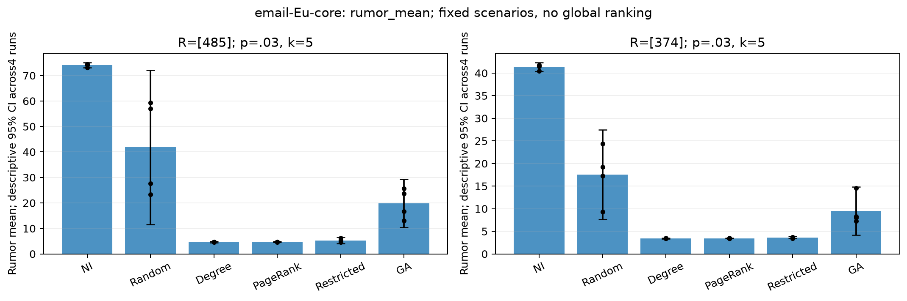

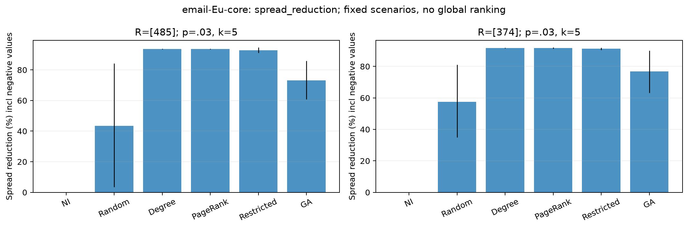

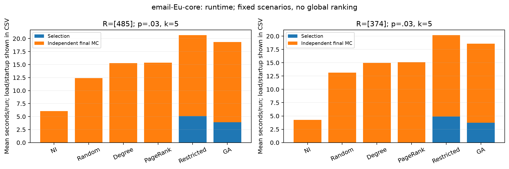

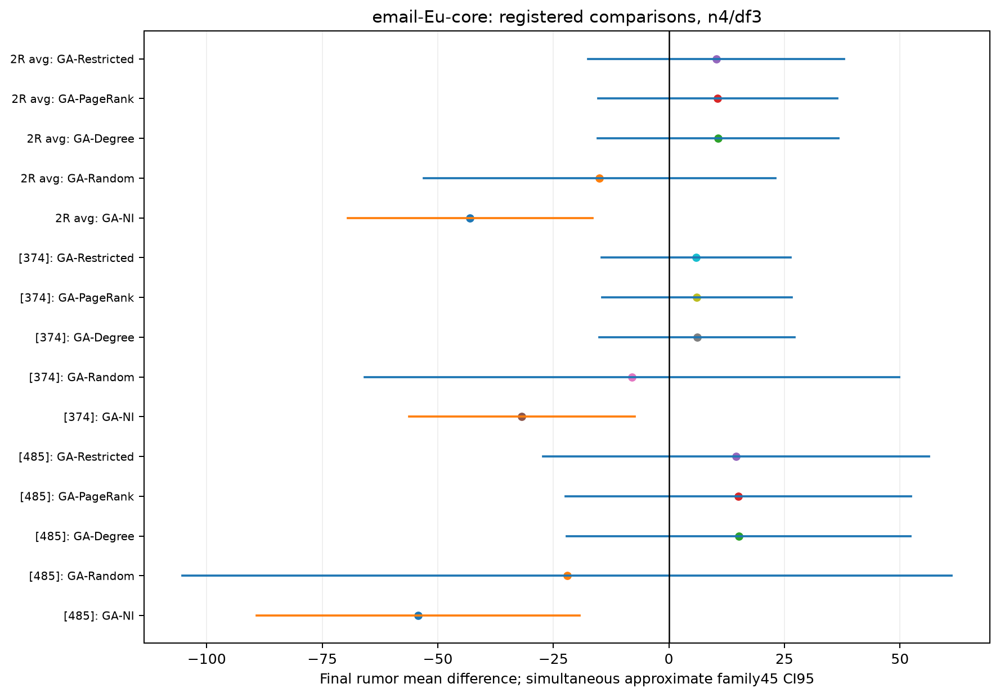
### ego-Facebook

Mỗi method/R có4 independent run estimates, mỗi P có2 final MC batches.
CI trong bảng mean là descriptive pointwise CI qua4 runs, không là interval
đã chỉnh family45. SD giữa run means chứa cả selection variability và MC noise;
conditional MC SE mô tả estimation error của một P đã khóa.
Trong results.csv, rumor_SD_sample là SD của các CIC observations cho từng P;
SD giữa run means trong bảng này là đại lượng khác, không dùng thay cho SD đó.

| R | Method | NI mean | Final mean | SD giữa run means | SE qua4 runs | CI95 qua4 runs | Mean conditional MC SE | Reduction | Selection s/run | Total CIC |
|---|---|---:|---:|---:|---:|---|---:|---:|---:|---:|
| [714] | no_intervention | 2.450 | 2.450 | 0.103 | 0.052 | [2.286, 2.614] | 0.075 | 0.00% | 0.00 | 20000 |
| [714] | random | 2.450 | 2.470 | 0.062 | 0.031 | [2.371, 2.569] | 0.075 | -0.81% | 0.00 | 20000 |
| [714] | degree | 2.450 | 2.453 | 0.067 | 0.033 | [2.347, 2.560] | 0.075 | -0.13% | 0.00 | 20000 |
| [714] | pagerank | 2.450 | 2.453 | 0.067 | 0.033 | [2.347, 2.560] | 0.075 | -0.13% | 0.18 | 20000 |
| [714] | candidate_restricted_greedy | 2.450 | 2.505 | 0.130 | 0.065 | [2.298, 2.713] | 0.082 | -2.26% | 34.20 | 36000 |
| [714] | genetic_algorithm | 2.450 | 2.495 | 0.092 | 0.046 | [2.349, 2.642] | 0.077 | -1.85% | 28.21 | 34100 |
| [2733] | no_intervention | 221.507 | 221.507 | 3.302 | 1.651 | [216.253, 226.761] | 5.529 | 0.00% | 0.00 | 20000 |
| [2733] | random | 221.507 | 121.931 | 53.462 | 26.731 | [36.862, 207.000] | 3.460 | 44.95% | 0.00 | 20000 |
| [2733] | degree | 221.507 | 13.254 | 0.343 | 0.171 | [12.708, 13.799] | 0.343 | 94.02% | 0.00 | 20000 |
| [2733] | pagerank | 221.507 | 13.254 | 0.343 | 0.171 | [12.708, 13.799] | 0.343 | 94.02% | 0.18 | 20000 |
| [2733] | candidate_restricted_greedy | 221.507 | 14.107 | 1.295 | 0.648 | [12.046, 16.168] | 0.478 | 93.63% | 37.52 | 36000 |
| [2733] | genetic_algorithm | 221.507 | 44.054 | 18.865 | 9.432 | [14.036, 74.072] | 1.582 | 80.11% | 31.21 | 35000 |

Summary trong dataset là equal weights1/2 cho hai fixed R,4 paired bundles.
Không diễn giải CI này là inference trên population tất cả nguồn rumor.

| Method | Equal-R final mean | Descriptive CI95 bundles | Equal mean of scenario reduction ratios | Min/max scenario means |
|---|---:|---|---:|---|
| no_intervention | 111.979 | [109.324, 114.633] | 0.00% | [2.450, 221.507] |
| random | 62.200 | [19.664, 104.737] | 22.07% | [2.470, 121.931] |
| degree | 7.854 | [7.558, 8.149] | 46.94% | [2.453, 13.254] |
| pagerank | 7.854 | [7.558, 8.149] | 46.94% | [2.453, 13.254] |
| candidate_restricted_greedy | 8.306 | [7.312, 9.300] | 45.69% | [2.505, 14.107] |
| genetic_algorithm | 23.275 | [8.195, 38.355] | 39.13% | [2.495, 44.054] |

Registered contrasts: GA−comparator; số âm favors GA. Trong scope dataset này,
2/15 effects có approximate family45 CI loại0.
Mỗi dòng chỉ nói về fixed scope đã ghi; không tạo global winner ranking.

| Scope R | Comparator | GA−comparator | Adjusted family45 CI95 | Evidence |
|---|---|---:|---|---|
| [714] | no_intervention | +0.045 | [-0.596, +0.687] | insufficient_evidence_of_difference_not_equivalence |
| [714] | random | +0.026 | [-0.737, +0.788] | insufficient_evidence_of_difference_not_equivalence |
| [714] | degree | +0.042 | [-0.459, +0.544] | insufficient_evidence_of_difference_not_equivalence |
| [714] | pagerank | +0.042 | [-0.459, +0.544] | insufficient_evidence_of_difference_not_equivalence |
| [714] | candidate_restricted_greedy | -0.010 | [-0.665, +0.645] | insufficient_evidence_of_difference_not_equivalence |
| [2733] | no_intervention | -177.453 | [-310.477, -44.428] | GA_lower_rumor_on_this_fixed_scope |
| [2733] | random | -77.877 | [-513.511, +357.758] | insufficient_evidence_of_difference_not_equivalence |
| [2733] | degree | +30.801 | [-87.555, +149.156] | insufficient_evidence_of_difference_not_equivalence |
| [2733] | pagerank | +30.801 | [-87.555, +149.156] | insufficient_evidence_of_difference_not_equivalence |
| [2733] | candidate_restricted_greedy | +29.947 | [-87.993, +147.888] | insufficient_evidence_of_difference_not_equivalence |
| 2R average | no_intervention | -88.704 | [-155.422, -21.986] | GA_lower_rumor_on_this_fixed_scope |
| 2R average | random | -38.926 | [-257.044, +179.193] | insufficient_evidence_of_difference_not_equivalence |
| 2R average | degree | +15.421 | [-43.928, +74.771] | insufficient_evidence_of_difference_not_equivalence |
| 2R average | pagerank | +15.421 | [-43.928, +74.771] | insufficient_evidence_of_difference_not_equivalence |
| 2R average | candidate_restricted_greedy | +14.969 | [-44.080, +74.018] | insufficient_evidence_of_difference_not_equivalence |

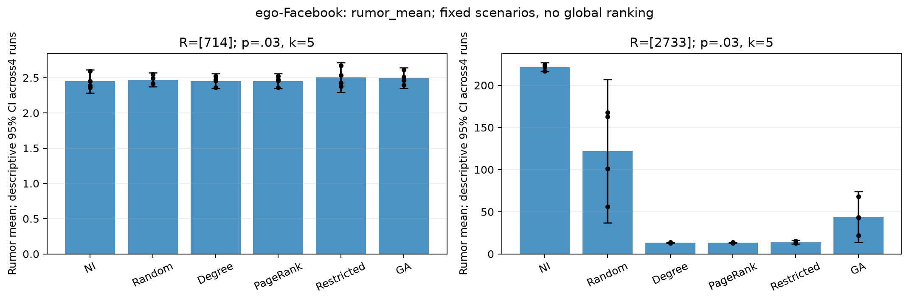

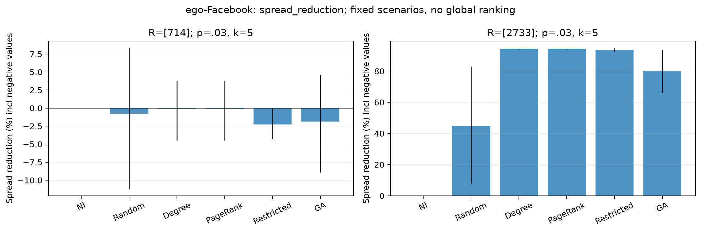

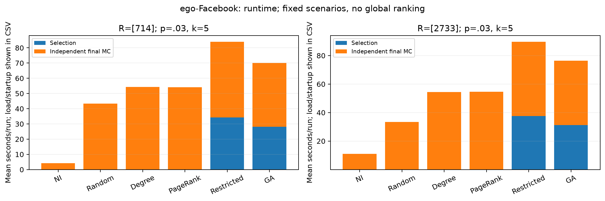

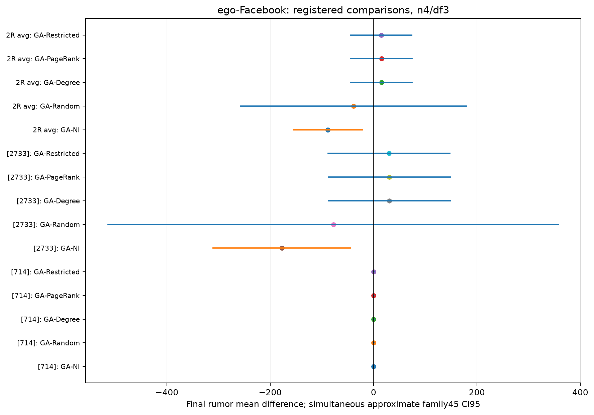
### Wiki-Vote

Mỗi method/R có4 independent run estimates, mỗi P có2 final MC batches.
CI trong bảng mean là descriptive pointwise CI qua4 runs, không là interval
đã chỉnh family45. SD giữa run means chứa cả selection variability và MC noise;
conditional MC SE mô tả estimation error của một P đã khóa.
Trong results.csv, rumor_SD_sample là SD của các CIC observations cho từng P;
SD giữa run means trong bảng này là đại lượng khác, không dùng thay cho SD đó.

| R | Method | NI mean | Final mean | SD giữa run means | SE qua4 runs | CI95 qua4 runs | Mean conditional MC SE | Reduction | Selection s/run | Total CIC |
|---|---|---:|---:|---:|---:|---|---:|---:|---:|---:|
| [1961] | no_intervention | 6.392 | 6.392 | 1.017 | 0.508 | [4.774, 8.009] | 0.640 | 0.00% | 0.00 | 20000 |
| [1961] | random | 6.392 | 5.372 | 1.791 | 0.895 | [2.522, 8.222] | 0.527 | 15.95% | 0.00 | 20000 |
| [1961] | degree | 6.392 | 1.465 | 0.047 | 0.023 | [1.390, 1.539] | 0.048 | 77.09% | 0.00 | 20000 |
| [1961] | pagerank | 6.392 | 4.830 | 0.452 | 0.226 | [4.111, 5.549] | 0.500 | 24.44% | 0.20 | 20000 |
| [1961] | candidate_restricted_greedy | 6.392 | 1.516 | 0.079 | 0.039 | [1.390, 1.641] | 0.053 | 76.29% | 15.57 | 36000 |
| [1961] | genetic_algorithm | 6.392 | 6.378 | 2.251 | 1.125 | [2.796, 9.959] | 0.615 | 0.22% | 6.85 | 32000 |
| [1795] | no_intervention | 88.456 | 88.456 | 5.204 | 2.602 | [80.175, 96.737] | 2.369 | 0.00% | 0.00 | 20000 |
| [1795] | random | 88.456 | 73.957 | 15.085 | 7.543 | [49.953, 97.961] | 2.083 | 16.39% | 0.00 | 20000 |
| [1795] | degree | 88.456 | 10.243 | 0.189 | 0.095 | [9.942, 10.545] | 0.294 | 88.42% | 0.00 | 20000 |
| [1795] | pagerank | 88.456 | 64.863 | 1.438 | 0.719 | [62.575, 67.152] | 1.911 | 26.67% | 0.18 | 20000 |
| [1795] | candidate_restricted_greedy | 88.456 | 7.524 | 0.295 | 0.148 | [7.054, 7.994] | 0.217 | 91.49% | 15.17 | 36000 |
| [1795] | genetic_algorithm | 88.456 | 58.905 | 6.912 | 3.456 | [47.907, 69.903] | 1.750 | 33.41% | 9.01 | 33100 |

Summary trong dataset là equal weights1/2 cho hai fixed R,4 paired bundles.
Không diễn giải CI này là inference trên population tất cả nguồn rumor.

| Method | Equal-R final mean | Descriptive CI95 bundles | Equal mean of scenario reduction ratios | Min/max scenario means |
|---|---:|---|---:|---|
| no_intervention | 47.424 | [44.039, 50.808] | 0.00% | [6.392, 88.456] |
| random | 39.665 | [28.154, 51.175] | 16.17% | [5.372, 73.957] |
| degree | 5.854 | [5.676, 6.031] | 82.75% | [1.465, 10.243] |
| pagerank | 34.847 | [33.827, 35.866] | 25.56% | [4.830, 64.863] |
| candidate_restricted_greedy | 4.520 | [4.316, 4.724] | 83.89% | [1.516, 7.524] |
| genetic_algorithm | 32.641 | [27.150, 38.133] | 16.81% | [6.378, 58.905] |

Registered contrasts: GA−comparator; số âm favors GA. Trong scope dataset này,
4/15 effects có approximate family45 CI loại0.
Mỗi dòng chỉ nói về fixed scope đã ghi; không tạo global winner ranking.

| Scope R | Comparator | GA−comparator | Adjusted family45 CI95 | Evidence |
|---|---|---:|---|---|
| [1961] | no_intervention | -0.014 | [-13.392, +13.364] | insufficient_evidence_of_difference_not_equivalence |
| [1961] | random | +1.006 | [-4.176, +6.187] | insufficient_evidence_of_difference_not_equivalence |
| [1961] | degree | +4.913 | [-9.026, +18.852] | insufficient_evidence_of_difference_not_equivalence |
| [1961] | pagerank | +1.548 | [-13.620, +16.716] | insufficient_evidence_of_difference_not_equivalence |
| [1961] | candidate_restricted_greedy | +4.862 | [-9.485, +19.209] | insufficient_evidence_of_difference_not_equivalence |
| [1795] | no_intervention | -29.551 | [-75.454, +16.352] | insufficient_evidence_of_difference_not_equivalence |
| [1795] | random | -15.052 | [-141.794, +111.689] | insufficient_evidence_of_difference_not_equivalence |
| [1795] | degree | +48.662 | [+6.685, +90.638] | comparator_lower_rumor_on_this_fixed_scope |
| [1795] | pagerank | -5.959 | [-54.882, +42.965] | insufficient_evidence_of_difference_not_equivalence |
| [1795] | candidate_restricted_greedy | +51.381 | [+8.808, +93.954] | comparator_lower_rumor_on_this_fixed_scope |
| 2R average | no_intervention | -14.783 | [-37.408, +7.843] | insufficient_evidence_of_difference_not_equivalence |
| 2R average | random | -7.023 | [-68.528, +54.482] | insufficient_evidence_of_difference_not_equivalence |
| 2R average | degree | +26.787 | [+5.881, +47.694] | comparator_lower_rumor_on_this_fixed_scope |
| 2R average | pagerank | -2.205 | [-27.142, +22.731] | insufficient_evidence_of_difference_not_equivalence |
| 2R average | candidate_restricted_greedy | +28.122 | [+7.058, +49.185] | comparator_lower_rumor_on_this_fixed_scope |

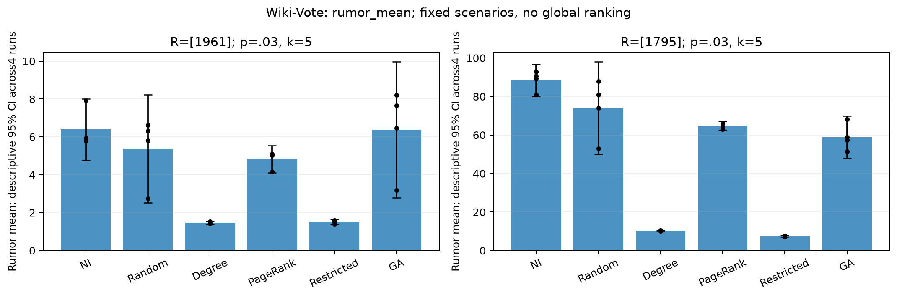

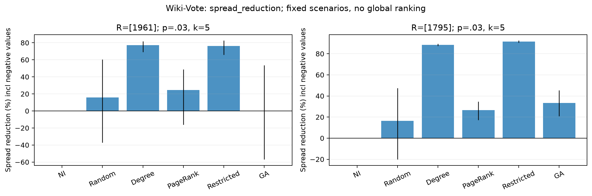

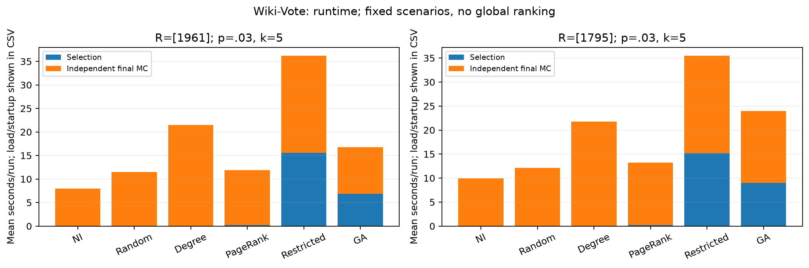

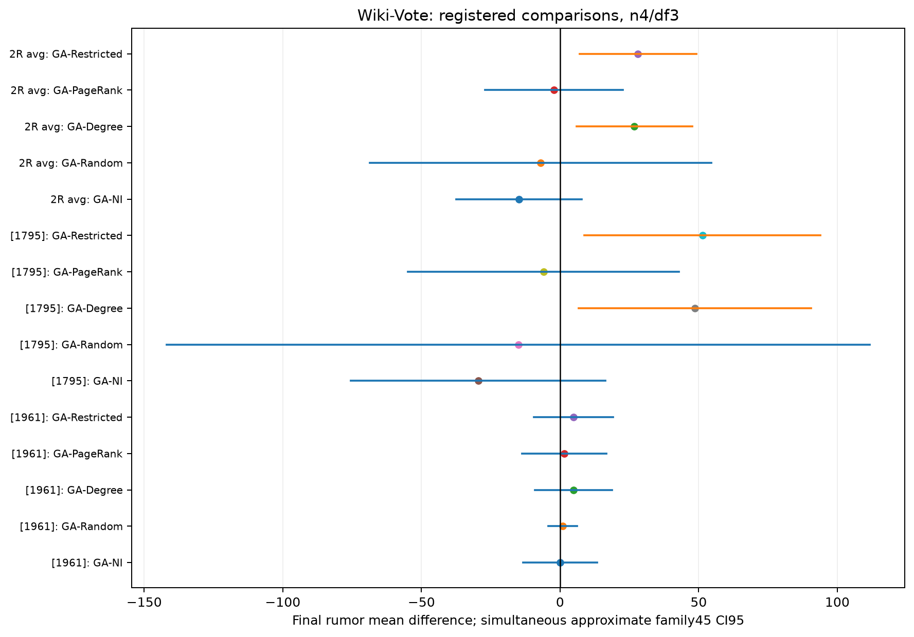

## 4. Negative reductions, MC uncertainty and algorithm variability

Spread reduction=1−ratio of across-run method/control means cho mỗiR; dataset
summary lấy mean của hai scenario ratios, không ngầm weight theo control size.
Run-level ratios cũng giữ để audit; không thay thế primary ratio-of-means.
**Không clip negative reduction**: 19 completed rows âm được giữ.
Cùng final seed cho phép ghép cặp observations, nhưng CIC tiêu thụ RNG theo
các activation attempts thực tế; không bảo đảm cùng một số ngẫu nhiên cho
cùng cạnh khi P thay đổi. Vì vậy không suy ra pathwise monotonicity từ seed
chung hoặc diễn giải một reduction âm riêng lẻ là hiệu ứng kỳ vọng đã xác nhận.

| Dataset | R | Method | Run | Reduction âm |
|---|---|---|---:|---:|
| ego-Facebook | [714] | random | 0 | -1.837% |
| ego-Facebook | [714] | degree | 0 | -0.286% |
| ego-Facebook | [714] | pagerank | 0 | -0.286% |
| ego-Facebook | [714] | candidate_restricted_greedy | 0 | -3.642% |
| ego-Facebook | [714] | genetic_algorithm | 0 | -6.746% |
| ego-Facebook | [714] | random | 1 | -7.780% |
| ego-Facebook | [714] | candidate_restricted_greedy | 1 | -0.762% |
| ego-Facebook | [714] | genetic_algorithm | 1 | -1.397% |
| ego-Facebook | [714] | random | 2 | -1.145% |
| ego-Facebook | [714] | degree | 2 | -3.393% |
| ego-Facebook | [714] | pagerank | 2 | -3.393% |
| ego-Facebook | [714] | candidate_restricted_greedy | 2 | -1.479% |
| ego-Facebook | [714] | genetic_algorithm | 2 | -2.808% |
| ego-Facebook | [714] | candidate_restricted_greedy | 3 | -3.037% |
| Wiki-Vote | [1961] | random | 2 | -6.698% |
| Wiki-Vote | [1961] | genetic_algorithm | 2 | -9.287% |
| Wiki-Vote | [1961] | random | 3 | -14.467% |
| Wiki-Vote | [1961] | genetic_algorithm | 3 | -41.629% |
| Wiki-Vote | [1795] | random | 1 | -8.513% |

Descriptive Fieller ratio CIs giữ bounded/unbounded/disjoint confidence sets;
endpoint null nghĩa là unbounded, không phải0. Dataset ratio CI dùng equal sum
hai97.5%Fieller sets, conservative descriptive95% union-bound approximation.
Các ratio intervals không là thêm primary significance tests trong family45.

MC SD/SE mô tả final observations với P cố định. SD giữa4 means còn chứa MC
noise; raw Var(run means)−mean(MC SE²) kể cả âm được giữ, display clipped riêng,
không coi giá trị âm là bằng chứng GA không biến động. NI/Degree/PageRank có
selection variability=0 theo cấu trúc, final repeats đoMC; Random/Greedy-MC/GA
còn có selection variability. Jaccard/unique P counts được lưu riêng. Scenario
heterogeneity là sự khác nhau giữa hai fixed R, không phải extra GA repeats;
report min/max means và per-R effects, không tạo CI trên population all sources.

## 5. Training fitness, convergence and independent quality

| Dataset | R | Optimizer | Training fitness mean | Independent final mean | Final−training mean |
|---|---|---|---:|---:|---:|
| email-Eu-core | [485] | candidate_restricted_greedy | 4.550 | 5.264 | +0.714 |
| email-Eu-core | [485] | genetic_algorithm | 13.387 | 19.794 | +6.406 |
| email-Eu-core | [374] | candidate_restricted_greedy | 2.535 | 3.624 | +1.089 |
| email-Eu-core | [374] | genetic_algorithm | 4.077 | 9.540 | +5.463 |
| ego-Facebook | [714] | candidate_restricted_greedy | 1.792 | 2.505 | +0.713 |
| ego-Facebook | [714] | genetic_algorithm | 1.535 | 2.495 | +0.960 |
| ego-Facebook | [2733] | candidate_restricted_greedy | 11.203 | 14.107 | +2.904 |
| ego-Facebook | [2733] | genetic_algorithm | 31.280 | 44.054 | +12.774 |
| Wiki-Vote | [1961] | candidate_restricted_greedy | 1.163 | 1.516 | +0.353 |
| Wiki-Vote | [1961] | genetic_algorithm | 1.202 | 6.378 | +5.175 |
| Wiki-Vote | [1795] | candidate_restricted_greedy | 4.918 | 7.524 | +2.606 |
| Wiki-Vote | [1795] | genetic_algorithm | 42.102 | 58.905 | +16.802 |

GA và Greedy fitness được đánh giá fixedS100 khi lựa chọn, có selection bias;
không dùng làm kết quả thực nghiệm cuối. Elites/cache giữ semantics cũ.
Convergence là generation0..10,4GA runs/R, không dùng điểm training thấp nhất
để đổi cấu hình hoặc chọn lại kết quả main. Dataset plots:

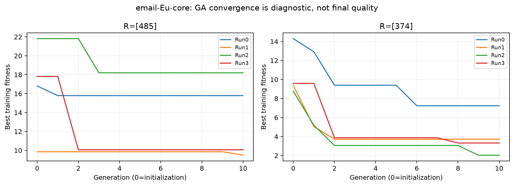

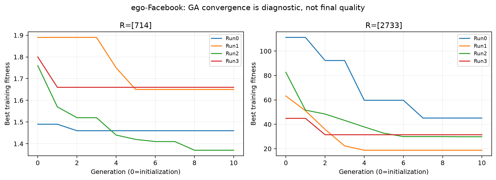

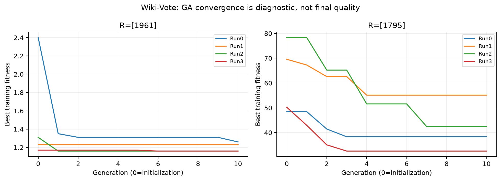

## 6. Runtime, CIC cost and checkpoints

Preflight upper3648 evaluator calls/1.392.000CIC; proxy safety+overhead
8889.537s, budget10800s. **Actual 2058 evaluator
calls/1,233,000 CIC**, gồm optimization
1770calls/177,000CIC;
final288calls/1,056,000CIC.
Conservative charged CIC=1233000; unknown partial
work nếu có không được ghi thành actual0. Cache hits=1590,
elite fitness reuses=240; không đếm chúng như
evaluator calls mới. Peak worker=205.8MiB.

| Runtime component đã đo | Giây |
|---|---:|
| Selection/optimization | 784.963 |
| Fitness MC, subset trong selection, không cộng lần hai | 778.128 |
| Independent final MC | 3322.551 |
| Graph loading | 35.406 |
| Worker graph copy/statistics/bookkeeping | 44.235 |
| Process startup/resource guard/output | 247.128 |
| Parent orchestration | 2.029 |
| **Total active execution** | **4436.312** |

Runtime CSV có selection/final/total theo dataset/method, mỗi result row có
timings riêng. Total gồm load/import/resource guard/JSON, không đồng nhất với
selection. Tests/analysis/plotting tách khỏi algorithm runtime. Atomic ledger
lưu từng selection/batch, verify code/graph/config/P/seed fingerprint khi resume,
không chạy lại units hoàn tất hoặc reset cumulative time/CIC caps. Actual
sequence và selection_barrier được audit, bảo đảm allP before allfinal.

## 7. Verification, reproducibility and limits

**493/493 tests pass**. 67 existing protected files, gồm 14 data files, giữ checksum. File set/topology raw/processed không đổi.
Statistical outputs được tính lại từ raw counts/checkpoints và kiểm tra
consistency; không resimulate main ngoài matrix để tạo thêm observations.
Reproducibility scope: frozen RNG schedules, prior core/adapter determinism
tests, raw/selection hashes, numeric re-aggregation và no-duplicate resume;
không claim đã rerun toàn bộ official MC lần hai. Runtime/hardware scheduling
không được kỳ vọng bit-identical. Prior5 protocol/calibration/screen/confirmation
artifacts được đối chiếu độc lập, không ghi đè.

Giới hạn: chỉ2high/constant R mỗi dataset, p/k cố định,4 independent runs,
S_opt100 noisy fitness, conditional MC accuracy khác nhau giữa P/R, t/Fieller
approximations với heavy tails. Những effects chưa phân biệt giữ unresolved;
không tiếp tục tuning GA hoặc bổ sung experiment sau khi thấy main quality.

Outputs: [results.csv](docs/main_experiments_results/results.csv),
[results.json](docs/main_experiments_results/results.json),
[summary_by_dataset.csv](docs/main_experiments_results/summary_by_dataset.csv),
[summary_by_scenario.csv](docs/main_experiments_results/summary_by_scenario.csv),
[method_comparisons.csv](docs/main_experiments_results/method_comparisons.csv),
[runtime_summary.csv](docs/main_experiments_results/runtime_summary.csv),
[GA_convergence.csv](docs/main_experiments_results/GA_convergence.csv),
[Full_Greedy_skipped.csv](docs/main_experiments_results/Full_Greedy_skipped.csv).
Compact per-run JSON/figures/config/metadata/audits ở docs/main_experiments_results;
complete raw arrays/details/worker jobs/checkpoints ở results/main_experiments_v2
(gitignored), có inventory SHA256. results.csv có144 primary rows, Full skips24
lưu riêng; method_status có168 rows để không nhầm số kết quả hoàn thành.
