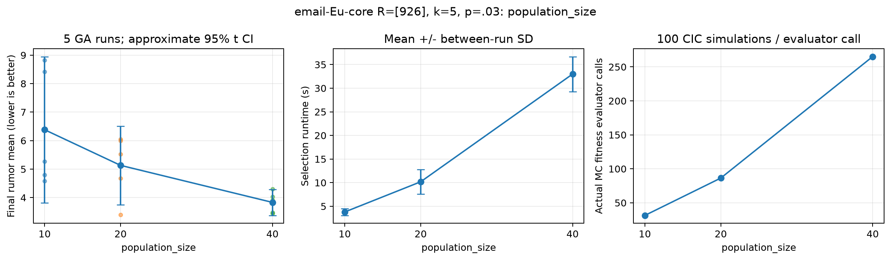
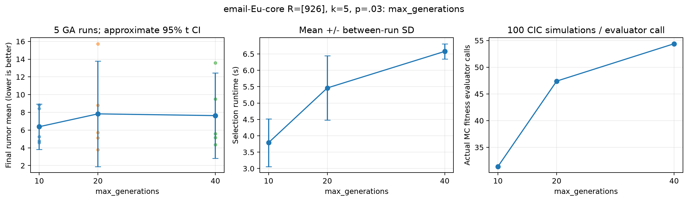
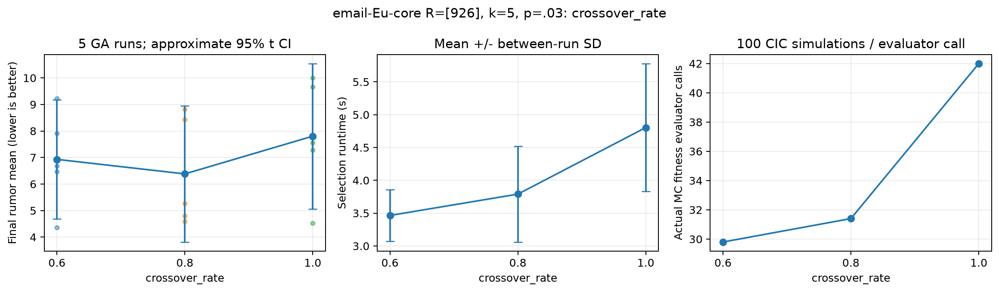
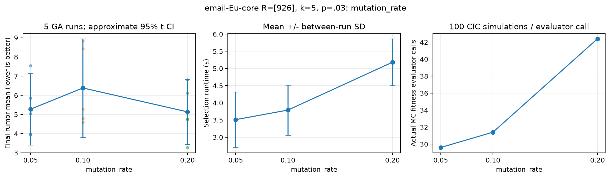
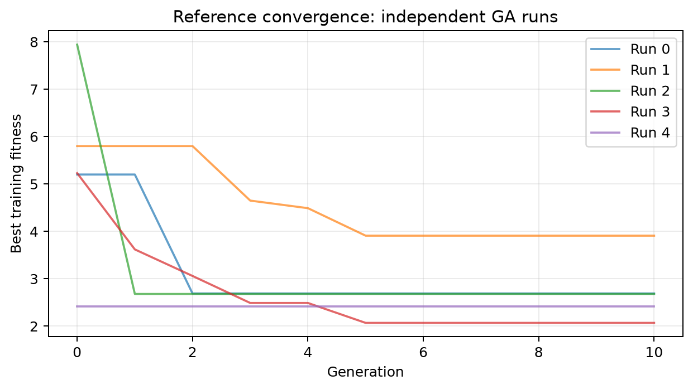
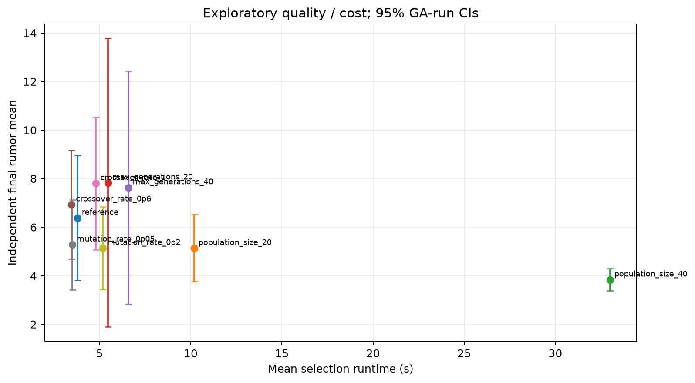

# Milestone 7 – Reduced GA Parameter Screening V2

Trạng thái: **completed**, 45/45 GA runs thành công,
0 thất bại, 0 skipped;
0 interrupted/failed attempts.
Không chạy Full Design hoặc main experiments. Số liệu dưới đây đã chạy thực tế,
trừ các hàng ghi rõ projected/upper bound. V2 không ghi đè kết quả preflight cũ.

## 1. Audit ma trận trước và phạm vi OFAT

Blueprint của Protocol v1 có 9 cấu hình duy nhất. Reduced subset cũ lấy 5:
reference, population20, generations20, crossover0.6, mutation0.2, và **lặp đủ
5 profile trên mỗi** email R926, Facebook R1180, Wiki R1210. Không chia 9
profile thành 3 phần rồi phân cho 3 dataset. Mỗi scenario có 25 planned runs,
tổng 75, tất cả skipped tại preflight runtime 10.985,164 > 10.800 giây.

| Scenario cũ | Population levels | Generations levels | Crossover levels | Mutation levels | Đủ ba mức? |
|---|---|---|---|---|---|
| email-Eu-core R=[926] | 10,20 | 10,20 | 0.6,0.8 | 0.1,0.2 | Không panel nào |
| ego-Facebook R=[1180] | 10,20 | 10,20 | 0.6,0.8 | 0.1,0.2 | Không panel nào |
| Wiki-Vote R=[1210] | 10,20 | 10,20 | 0.6,0.8 | 0.1,0.2 | Không panel nào |

Audit 60 planned pairs: không pair nào đổi dataset, R hoặc biến cố định khác;
chỉ đối chiếu reference với đúng một thay đổi. Bốn panel có thể phân tích
two-level contrasts **trong từng scenario nếu đã chạy**; vì 0 completed runs
nên chưa có phân tích thực nghiệm nào từ matrix cũ. Không ghép kết quả khác
dataset để suy ra ảnh hưởng riêng của tham số. File: [audit_previous.json](docs/milestone_7_reduced_screen_v2/audit_previous.json).

## 2. Ma trận V2 đã cố định trước khi chạy

**9 profiles × 1 scenario × 5 independent GA runs =45 tổng.** Reference chỉ
chạy 5 lần rồi dùng chung cho cả bốn panel (12 panel rows, không phải 60 runs).
Các tham số không khảo sát giữ nguyên reference Protocol v1.

| Profile | N | G | Crossover | Mutation | Repeats |
|---|---:|---:|---:|---:|---:|
| reference | 10 | 10 | 0.8 | 0.1 | 5 |
| population_size_20 | 20 | 10 | 0.8 | 0.1 | 5 |
| population_size_40 | 40 | 10 | 0.8 | 0.1 | 5 |
| max_generations_20 | 10 | 20 | 0.8 | 0.1 | 5 |
| max_generations_40 | 10 | 40 | 0.8 | 0.1 | 5 |
| crossover_rate_0p6 | 10 | 10 | 0.6 | 0.1 | 5 |
| crossover_rate_1 | 10 | 10 | 1.0 | 0.1 | 5 |
| mutation_rate_0p05 | 10 | 10 | 0.8 | 0.05 | 5 |
| mutation_rate_0p2 | 10 | 10 | 0.8 | 0.2 | 5 |

Điều kiện chung: email-Eu-core, R=[926], k=5, p=0.03,
tie=protector-priority, tournament=3, elitism=1, cache=True; S_opt=100;
S_eval=6.000/batch và B=2, tức 12.000 final CIC simulations cho mỗi P.
[Matrix 45 dòng đầy đủ seed labels](docs/milestone_7_reduced_screen_v2/matrix.csv),
[request JSON](experiments/configs/milestone_7_reduced_screen_v2.json).
Không sửa reference hoặc factor levels trong Protocol v1.
Authorization flag lịch sử trong v1 không được sửa; quyền chạy V2 có điều kiện
đến từ yêu cầu mới của người dùng, và preflight đã đạt trước run đầu.

Chọn scenario từ topology/No Intervention của Pilot 2: R926 reachable=965/1.005,
bao gồm seed; No Intervention tại p=.03, S=200 có mean=34.68, std=88.829,
SE=6.297, rumor fraction=3.451%. Đây là representative đã xác định trước,
đạt control gate [2%,80%] số nút và dưới 90% reachable. Không dùng score GA
để chọn R/p. 75.5% Pilot-2 observations không lan ngoài seed cho thấy phân bố
còn nhiều zero-growth events; không khẳng định scenario này đại diện mọi R.
Low-reach scenarios vẫn được giữ trong manifest cho phân tích bổ sung.

Seed master V2=2026111110, tách pilot=2026111107, preflight cũ=2026111108 và
reserved main=2026111109. Block width=1.000.000, Cantor(master,index) như runner
đã kiểm chứng. Optimization index=(scenario_index+1)*10000+profile_ordinal*100+repeat:
45 bộ optimizer/fitness seed riêng. Mỗi GA dùng một fitness schedule cố định
100 seeds và cache cục bộ; elite giữ nguyên fitness theo GA hiện có.
Final index=scenario_index*100+repeat, sử dụng nửa final của block, hai batch
liền kề 6.000 seeds. Final schedules giống nhau giữa profiles trong cùng repeat,
khác giữa repeats và không giao bất kỳ optimization interval nào. Cùng final
seed không bảo đảm từng edge có cùng random outcome vì số valid attempts phụ
thuộc P. Khác seed optimizer giữa profiles là replication theo cùng policy,
không phải đổi điều kiện nghiên cứu OFAT.

Ma trận và policy phân tích đã đóng băng trước run đầu. Với từng run, chọn
và khóa P trước final evaluation; final không được trả về optimizer và không
được dùng để sửa matrix. Shared No Intervention chỉ chạy sau tất cả GA runs.
V2 đánh giá final ngay sau từng GA, khác selection-barrier của pilot cũ nhưng
không có adaptation/cross-run fitness reuse hoặc thay đổi semantics.

## 3. Computational preflight và chi phí đo thực tế

Bound fitness calls mỗi run: U=N+G(N−elitism), không tính cache hits/elite
carries là evaluator calls. Sum U của 9 profiles=1.700, nhân 5 repeats=8.500.

| Thành phần | Evaluator calls upper | CIC simulations upper |
|---|---:|---:|
| Optimization, S_opt100 | 8.500 | 850.000 |
| Final, 45×2×6.000 | 90 | 540.000 |
| Shared controls, 5×2×6.000 | 10 | 60.000 |
| Tổng | 8.600 | 1.450.000 |

Pilot-2 email rates: fitness=0.001189884 s/CIC, final=0.001293115 s/CIC,
control=0.000323939 s/CIC, cộng non-MC history cost. Đây là measured source rates
trên một R, **không phải thời gian V2 đã đo hoặc hard upper bound**.
Projection trước safety=1732.164 s;
nhân 1.5=2598.246 s, thêm allowance
loading/export/setup 300 s thành **2898.246 s**.
Headroom so với cap 10.800 s=7901.754 s.
Count caps: 120 GA runs, 3.000.000 CIC; schedule V2 chỉ cho phép 45 planned GA.
Timeout một worker tối đa 600 s, luôn cắt theo active budget còn lại.

**Đã đo**: 3143 fitness calls + 90 final calls
+ 10 control calls = 3243 evaluator calls;
914,300 CIC simulations, gồm
314,300 optimization + 540,000 final
+ 60,000 control; cache hits=5357,
elite fitness reuses=650.

| Runtime component, đã đo | Giây |
|---|---:|
| Selection/optimization | 379.841 |
| Fitness MC (đã nằm trong selection, không cộng lần hai) | 376.503 |
| Independent GA final evaluation | 680.591 |
| Shared controls | 19.243 |
| Graph loading | 1.376 |
| Worker bookkeeping/graph copy/statistics | 2.053 |
| Process startup/output | 33.660 |
| Parent orchestration | 0.189 |
| **Tổng active experiment runtime** | **1116.953** |

Test/analysis/plotting runtime báo riêng, không giả làm algorithm runtime.
Checkpoint ghi atomic sau từng unit; resume chỉ tiếp tục cùng fingerprint
code/data/config, xác minh SHA256 result hoàn tất và bỏ qua units đã lưu.
Nếu bị gián đoạn trước khi publish result thì charge conservatively upper
CIC và timeout, không ghi unknown work=0. Cumulative budget không reset khi resume.
Raw checkpoints/counts và full GA records ở results/milestone_7_reduced_screen_v2
(gitignored); compact CSV/JSON/history được lưu trong docs và inventory có hashes.

## 4. Chất lượng, ổn định và ảnh hưởng từng tham số

SD giữa 5 GA-run means **có cả MC noise**; conditional MC SE chỉ đo bất định
ước lượng với một P cố định. CI qua GA runs dùng t(df=4), tính xấp xỉ với n=5,
không phải 60.000 independent GA repetitions.

| Profile | Training mean | Final mean ± between-run SD | CI95 qua GA runs | Mean conditional MC SE | Selection s/run | Fitness calls/run |
|---|---:|---|---|---:|---:|---:|
| reference | 2.754 | 6.383 ± 2.068 | [3.816, 8.950] | 0.207 | 3.79 | 31.4 |
| population_size_20 | 2.354 | 5.132 ± 1.112 | [3.751, 6.513] | 0.156 | 10.19 | 86.4 |
| population_size_40 | 1.808 | 3.833 ± 0.369 | [3.375, 4.291] | 0.113 | 32.99 | 265.2 |
| max_generations_20 | 2.146 | 7.831 ± 4.786 | [1.889, 13.773] | 0.248 | 5.46 | 47.4 |
| max_generations_40 | 2.612 | 7.634 ± 3.870 | [2.829, 12.439] | 0.245 | 6.58 | 54.4 |
| crossover_rate_0p6 | 3.476 | 6.930 ± 1.809 | [4.684, 9.177] | 0.234 | 3.46 | 29.8 |
| crossover_rate_1 | 3.746 | 7.804 ± 2.205 | [5.067, 10.542] | 0.262 | 4.80 | 42.0 |
| mutation_rate_0p05 | 3.070 | 5.277 ± 1.498 | [3.418, 7.137] | 0.167 | 3.51 | 29.6 |
| mutation_rate_0p2 | 2.120 | 5.138 ± 1.368 | [3.439, 6.836] | 0.160 | 5.18 | 42.4 |

No Intervention mới, cùng final seeds: mean qua 5 batches-pairs=30.822.
Spread reductions có trong run_results.csv; đây là kiểm chứng phạm vi screen,
không phải benchmark GA với các baseline hay kết quả chính thức của đồ án.

### Population size

Mỗi hàng so với reference, cùng R/k/p/tie/S và quy trình final evaluation.
Delta = alternative − reference; số âm là ít rumor hơn. Đây là hiệu ứng trên
một scenario development, chưa phải hiệu ứng tổng quát trên các dataset.

| Mức | Delta mean | CI95 pointwise | CI95 Bonferroni (8 contrasts) | Diễn giải |
|---|---:|---|---|---|
| 20 | -1.251 | [-3.547, +1.046] | [-5.601, +3.100] | insufficient_evidence_of_difference |
| 40 | -2.550 | [-5.168, +0.068] | [-7.511, +2.411] | insufficient_evidence_of_difference |

Final means N10/N20/N40 lần lượt 6.383/5.132/3.833. N40 cần khoảng 8.71 lần selection runtime của reference; N20 khoảng 2.69 lần. Đây là trade-off mô tả để xác nhận tiếp, chưa phải kết luận vượt trội.



[Training convergence theo panel](docs/milestone_7_reduced_screen_v2/figures/population_size_convergence.png).
### Generations

Mỗi hàng so với reference, cùng R/k/p/tie/S và quy trình final evaluation.
Delta = alternative − reference; số âm là ít rumor hơn. Đây là hiệu ứng trên
một scenario development, chưa phải hiệu ứng tổng quát trên các dataset.

| Mức | Delta mean | CI95 pointwise | CI95 Bonferroni (8 contrasts) | Diễn giải |
|---|---:|---|---|---|
| 20 | +1.449 | [-3.406, +6.303] | [-7.750, +10.648] | insufficient_evidence_of_difference |
| 40 | +1.251 | [-3.175, +5.677] | [-7.135, +9.638] | insufficient_evidence_of_difference |

Final means G10/G20/G40 lần lượt 6.383/7.831/7.634; SD giữa runs 2.068/4.786/3.870. Cache khiến actual fitness calls chỉ 31.4/47.4/54.4 mỗi run, thấp hơn nhiều uncached bounds. Không suy ra tăng G chắc chắn cải thiện hoặc làm xấu chất lượng từ các mean này.



[Training convergence theo panel](docs/milestone_7_reduced_screen_v2/figures/max_generations_convergence.png).
### Crossover rate

Mỗi hàng so với reference, cùng R/k/p/tie/S và quy trình final evaluation.
Delta = alternative − reference; số âm là ít rumor hơn. Đây là hiệu ứng trên
một scenario development, chưa phải hiệu ứng tổng quát trên các dataset.

| Mức | Delta mean | CI95 pointwise | CI95 Bonferroni (8 contrasts) | Diễn giải |
|---|---:|---|---|---|
| 0.6 | +0.548 | [-2.081, +3.176] | [-4.432, +5.528] | insufficient_evidence_of_difference |
| 1.0 | +1.422 | [-1.468, +4.311] | [-4.053, +6.897] | insufficient_evidence_of_difference |

Final means crossover0.6/0.8/1.0 lần lượt 6.930/6.383/7.804. Không dùng training means hoặc vị trí thấp nhất của đường mean để chốt crossover tối ưu.



[Training convergence theo panel](docs/milestone_7_reduced_screen_v2/figures/crossover_rate_convergence.png).
### Mutation rate

Mỗi hàng so với reference, cùng R/k/p/tie/S và quy trình final evaluation.
Delta = alternative − reference; số âm là ít rumor hơn. Đây là hiệu ứng trên
một scenario development, chưa phải hiệu ứng tổng quát trên các dataset.

| Mức | Delta mean | CI95 pointwise | CI95 Bonferroni (8 contrasts) | Diễn giải |
|---|---:|---|---|---|
| 0.05 | -1.105 | [-3.669, +1.459] | [-5.964, +3.753] | insufficient_evidence_of_difference |
| 0.2 | -1.245 | [-3.636, +1.146] | [-5.775, +3.285] | insufficient_evidence_of_difference |

Final means mutation0.05/0.1/0.2 lần lượt 5.277/6.383/5.138; selection runtime 3.51/3.79/5.18 s/run. Khác biệt mô tả không chứng minh winner hoặc equivalence.



[Training convergence theo panel](docs/milestone_7_reduced_screen_v2/figures/mutation_rate_convergence.png).

## 5. Hội tụ, fitness noise và giới hạn diễn giải





Convergence.csv/json có generation0 đến đúng G, best/mean fitness, selected P,
cache counters và thời gian. Training fitness dùng fixed schedule nhỏ, đã được
tối ưu trực tiếp nên có thể lạc quan. Không dùng đường training làm final quality.
Run-level training–independent gap và hai batch conditional CIs được lưu riêng.
Đường của G20/G40 không phải phần nối tiếp một G10 run vì optimizer seeds riêng.

Tám planned contrasts là alt−reference, paired theo repeat/final schedule.
Pointwise CI95 và simultaneous Bonferroni CI95 (family tám contrasts) đều được
lưu. Chỉ diễn giải khác biệt nếu interval hiệu chỉnh loại 0; interval chứa 0
nghĩa là **chưa đủ bằng chứng**, không phải tương đương. Năm pairs nhỏ và rumor
skew làm t intervals chỉ có tính thăm dò, chưa bảo đảm coverage.
Số contrasts với CI family loại 0: 0/8.
Không kiểm định thêm mọi cặp giữa hai alternative levels; không suy ra khác
biệt N20−N40 từ việc một contrast với reference có ý nghĩa còn contrast kia
không. Chưa chốt ngưỡng practical significance hoặc equivalence margin.

Variance decomposition giữ raw Var(GA means)−mean(MC SE²), đồng thời có display
clipped>=0; giá trị âm không chứng minh GA hết biến động. Với contrasts, MC
variance dùng seed-aligned raw differences; không giả định independent errors
giữa hai profiles dùng chung final seeds. Genotype stability có unique P count
và pairwise Jaccard trong summary_by_configuration. Không ước lượng interaction
giữa factors bằng OFAT, không kết hợp các mức tốt nhất thành cấu hình chưa thử.

## 6. Ứng viên tiếp theo, kiểm chứng và dữ liệu xuất

Chưa đủ bằng chứng để thay reference bằng một mức tham số khác. Giữ N=10, G=10, crossover=0.8, mutation=0.1, tournament=3, elitism=1, cache=True làm ứng viên tham chiếu để kiểm tra tiếp trên dataset/scenario khác. Đây là lựa chọn tiết kiệm có điều kiện, không phải tham số tối ưu.

| Ứng viên cần xác nhận ở development scenarios khác | Vai trò | Mức chắc chắn hiện tại |
|---|---|---|
| N10/G10/crossover0.8/mutation0.1 | Giữ reference đã có, chi phí thấp | Khả thi trên R926; chưa xác nhận tối ưu |
| N20/G10/crossover0.8/mutation0.1 | Kiểm tra trade-off trung gian, chỉ đổi N | Thăm dò; CI effect còn chứa 0 |
| N40/G10/crossover0.8/mutation0.1 | Kiểm tra mean giảm mô tả có tái hiện với chi phí cao hơn không | Thăm dò; CI effect còn chứa 0 |

Bảng này không cấp quyền chạy thêm hoặc tự chọn N20/N40 cho main. Mọi bước
xác nhận khác dataset phải có preflight riêng; không ghép các outcomes đó để
suy ra một population effect thuần túy khi R/graph khác. Chưa có ứng viên mới
cho G/crossover/mutation đủ bằng chứng để thay reference.

Độ chắc chắn về khả năng thực thi: có số liệu V2 ở một scenario. Độ chắc chắn
về chất lượng tổng quát: còn thấp vì chỉ email/high-reach R926, một k/p, 5 runs,
fixed training seeds và nhiều zero-growth events. Cần xác nhận trên development
scenarios khác với namespace mới trước khi chốt GA; không dùng validation/main
holdouts để tiếp tục tuning. Reserved R858/1555/2110 và main master vẫn chưa dùng
trong V2. Các low/legacy scenarios còn trong manifest để phân tích bổ sung.

415/415 tests pass; 44 protected files và 14 data files không đổi.
IC/CIC/Monte Carlo/Greedy/GA và Protocol-v1 JSON không đổi. Không chạy main
experiments, Full Design, Facebook/Wiki parameter sweep hoặc tự tăng budget.

Đầu ra chính: [summary.json](docs/milestone_7_reduced_screen_v2/summary.json),
[run_results.csv](docs/milestone_7_reduced_screen_v2/run_results.csv),
[summary_by_configuration.csv](docs/milestone_7_reduced_screen_v2/summary_by_configuration.csv),
[contrasts.csv](docs/milestone_7_reduced_screen_v2/contrasts.csv),
[convergence.csv](docs/milestone_7_reduced_screen_v2/convergence.csv),
[final_batches.csv](docs/milestone_7_reduced_screen_v2/final_batches.csv),
[runtime.json](docs/milestone_7_reduced_screen_v2/runtime.json).
Mỗi run có JSON riêng trong docs/milestone_7_reduced_screen_v2/runs.

Chạy/tiếp tục cùng matrix:
```sh
.venv/bin/python -B -m experiments.reduced_screen_v2 --phase preflight
.venv/bin/python -B -u -m experiments.reduced_screen_v2 --phase run
.venv/bin/python -B -m experiments.analyze_reduced_screen_v2
.venv/bin/python -B -m unittest discover -s tests -q
```
