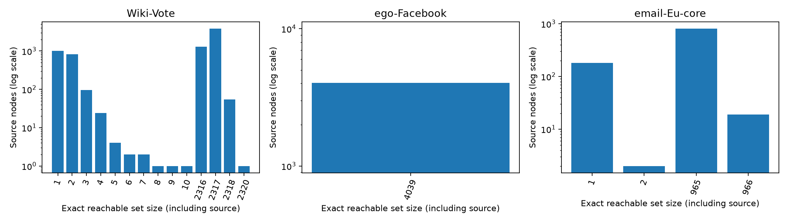
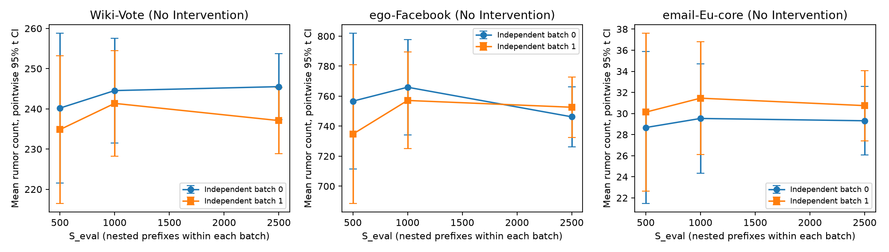

# Pilot 2 – Calibration of Rumor Seeds, Propagation Probability and Monte Carlo Accuracy

Đây là calibration pilot, **không phải main experiments hoặc Milestone 7**.
Mục tiêu là độ tin cậy của protocol, không tìm điều kiện để GA thắng. Không
sửa dataset, runner, IC/CIC/MC, GA, Greedy hoặc các baseline đã kiểm chứng.

Config thực thi: [pilot_2_calibration.json](experiments/configs/pilot_2_calibration.json).
CSV/JSON/figures compact: [docs/pilot_2_calibration](docs/pilot_2_calibration).
Raw observations, per-case configs/metadata/selection traces và logs nằm trong
`results/pilot_2_calibration/` (gitignored). Mọi kết quả bên dưới là **đã đo**
trừ các mục ghi rõ ngoại suy/đề xuất.

## 1. Reachability trên toàn bộ nguồn có thể chọn

Đếm cả node nguồn; CSV cũng có cột loại node nguồn để tránh nhầm định nghĩa.
DiGraph tuân theo hướng cạnh. Dùng SCC condensation DAG và union bitsets tính
reachable chính xác cho từng SCC; Graph vô hướng dùng connected components.
Bit positions là ordinal của actual node IDs, không phải ID; hỗ trợ IDs thưa.
Không có xác suất p hoặc thuật toán tối ưu trong phép phân tích này.

| Dataset | Nodes | Phân bố reachable set size → số node nguồn |
|---|---:|---|
| email-Eu-core | 1.005 | 1→181; 2→2; 965→803; 966→19 |
| ego-Facebook | 4.039 | 4.039→4.039 |
| Wiki-Vote | 7.115 | 1→1.005; 2→821; 3→96; 4→24; 5→4; 6→2; 7→2; 8→1; 9→1; 10→1; 2.316→1.300; 2.317→3.803; 2.318→54; 2.320→1 |

Xuất toàn bộ **12.159 node records**, histogram, mean/std và quantiles tuyến
tính trong `reachable_nodes.csv`, `reachable_histogram.csv`,
`reachable_summary.json`. Thuật toán được kiểm tra với BFS/descendants trên
192 nguồn thực tế và unit-test oracles, gồm cycles/branches/isolates/sparse IDs.



**Không tồn tại ba mức reachable tách biệt thật sự trên mọi dataset.** Quy tắc
strata được chốt trước mô phỏng: low ≤ max/3, medium ≤ 2max/3, high phần còn
lại; không tách các giá trị bằng nhau. Nếu mọi reachable bằng nhau, dùng một
stratum `constant`. Email và Wiki không có medium; Facebook không có low/
medium/high khác nhau về reachable. Các strata rỗng được ghi rõ, không tạo
nhóm giả bằng cách chia ID hoặc ranking ties.

Wiki có 1.957 nguồn reachable 1–10 và 5.158 nguồn reachable 2.316–2.320. “High”
ở đây là tương đối trong dataset; ngay maximum chỉ bằng khoảng **32,61% n**.
Với một rumor seed, bão hòa 90% toàn Wiki là bất khả thi về topology. Cần xem
thêm tỷ lệ kích hoạt trên reachable set, không chỉ trên toàn graph.

## 2. Rumor seed policy đã thực thi và đề xuất

Lấy mẫu đều không hoàn lại 2 actual IDs trong mỗi stratum không rỗng, bằng RNG
seed lấy 8 bytes đầu SHA-256 của
`pilot2-rumor-v1:20261111:{dataset}:{stratum}`. Danh sách R được ghi vào manifest
**trước mọi CIC/GA/Greedy**, không resample sau khi xem outcomes. Mỗi R có đúng
một node; sampling seed/draw index/role/reachable được lưu CSV/JSON.

| Dataset | Primary topology candidates | Supplemental low | Legacy supplement |
|---|---|---|---|
| email-Eu-core | [858] reachable=966; [926] reachable=965 | [761], [767], đều reachable=1 | — |
| ego-Facebook | [1180], [1555], đều reachable=4.039 (`constant`) | Không có stratum thấp | — |
| Wiki-Vote | [2110], [1210], đều reachable=2.317 | [5288], [6009], đều reachable=1 | [4341], reachable=2 |

Tổng 11 scenarios. R=[4341] không bị xóa; được giữ làm bổ sung và được khảo sát
đủ cả bốn p. Main evaluation của Wiki không nên chỉ dựa vào R này.

Đề xuất giữ sampling theo topology, công bố toàn bộ scenarios trước khi chạy
methods, phân tích strata riêng. Nếu cần ước lượng theo nguồn được chọn đều
trên toàn graph thì phải dùng đúng weights theo kích thước strata; không gộp
trung bình đều các nhóm đã oversample rồi gọi đó là uniform-node performance.
Không dùng chất lượng của bất kỳ thuật toán nào để chọn R.

Reachable một mình không dự báo được spread: hai R Facebook đều reachable
toàn graph nhưng mean ở p=0.03 lần lượt 795,525 và 175,555. Hai R Wiki cùng
reachable 2.317 nhưng mean p=0.03 là 5,015 và 217,335. Cần nhiều nguồn trong
mỗi stratum; có thể đề xuất sub-strata topology/local degree trước một đợt mới,
nhưng không lấy mẫu lại trong pilot này để thay outcomes đã quan sát.

## 3. Khảo sát p bằng No Intervention

Đã chạy 11 R × 4 p × 2 independent batches × S=100 = **8.800 CIC simulations**,
88 evaluator calls. Các bảng đầy đủ có mean, population std, sample SE,
pointwise 95% t CI, Wilson interval cho xác suất không lan thêm, fraction và
runtime. Bảng dưới là mean của 200 observations cho từng primary candidate:

| Dataset / R | p=0.01 | p=0.03 | p=0.05 | p=0.10 |
|---|---:|---:|---:|---:|
| email / [858] | 1,015 | 5,560 | 24,375 | 50,575 |
| email / [926] | 1,210 | 34,680 | 122,420 | 416,645 |
| Facebook / [1180] | 16,415 | 795,525 | 1.662,405 | 2.863,200 |
| Facebook / [1555] | 2,735 | 175,555 | 1.013,580 | 2.836,890 |
| Wiki / [2110] | 1,070 | 5,015 | 22,035 | 166,265 |
| Wiki / [1210] | 5,140 | 217,335 | 987,740 | 1.649,605 |

Các low seeds reachable=1 có rumor_count=1 xác định ở mọi p, vẫn giữ nguyên
trong kết quả. Legacy Wiki chỉ có thể đạt tối đa 2 nodes.

- **0.01:** ít spread trong các primary scenarios đã lấy mẫu; không đạt gate
  2% n của calibration. Giữ như negative/low-spread regime bổ sung.
- **0.03:** có các scenarios đủ spread trên cả ba dataset; được chọn làm mức
  calibration chung theo quy tắc dưới đây, trước khi chạy bất kỳ optimizer nào.
- **0.05:** tạo spread rõ hơn với một số R, là ứng viên sensitivity hợp lý;
  chỉ No Intervention đã được đo trong Pilot 2 ở mức này. Chưa hiệu chỉnh
  S_opt/S_eval của các thuật toán tại p=0.05/R mới.
- **0.10:** không bị loại theo kết quả GA. Trên Facebook mean khoảng 70–71% n;
  chưa đạt mean saturation 90%. Wiki [1210] đạt khoảng 71% reachable set nhưng
  chỉ 23,18% toàn graph. Chi phí cao hơn; giữ làm high-spread sensitivity cần
  ngân sách riêng, không tự chạy thêm optimizer matrix.

Không cell nào có mean ≥90% toàn graph trong đợt này. Không khái quát thành
mọi R/p trên dataset đều không bão hòa.

Gate calibration khai báo trước: primary topology candidate, control mean
trong [2%,80%] n và ≤90% reachable; chọn **p nhỏ nhất** đạt gate, tie theo
manifest order. Không dùng fitness/ranking. Các đại diện được chốt:

| Dataset | R | p | Control scan mean | Fraction graph | No-spread probability trong scan |
|---|---|---:|---:|---:|---:|
| email-Eu-core | [926] | 0.03 | 34,680 | 3,45% | 75,5% |
| ego-Facebook | [1180] | 0.03 | 795,525 | 19,70% | 22,0% |
| Wiki-Vote | [1210] | 0.03 | 217,335 | 3,05% | 0,5% |

Các R/p không được chọn làm đại diện vẫn có đầy đủ số đo, không bị xóa. Gate
là admission cho một pilot nhỏ, không xác nhận các R khác có cùng độ chính xác.

## 4. Preflight, giới hạn và phạm vi thực thi

Giữ k=5, protector-priority, GA N=10/G=10/crossover=.8/mutation=.1/tournament=3/
elite=1/cache=True; Restricted pool top-10 out-degree/degree ngoài R. Không
thay đổi các tham số GA để tăng kết quả. Full Greedy luôn vượt limit 100
calls/2.000 CIC và được ghi skipped, không thay bằng Restricted dưới tên Full.

Một comparison có tối đa 100 GA calls + đúng 40 Restricted calls. Baseline
selection không gọi MC. Với final S=500, sáu phương pháp cần 3.000 CIC final.
Cận comparison: `140*S_opt + 3000`; cận số calls: 146 (140 optimization + 6
final). GA cache có thể giảm actual calls, không giảm bằng cách đổi semantics.

Ma trận được giới hạn trước: email/Facebook đủ bốn S_opt × 2 repeats; Wiki
reference S_opt=100 × 2 repeats. Không nhân toàn bộ R × p × S × mọi methods.
Accuracy dùng P của S_opt=100/repeat 0 đã chốt, 2 batches độc lập, prefixes
500/1.000/2.500. Giới hạn tổng 450.000 CIC, 1.800 s active execution, 300 s mỗi
comparison. Original upper bound **416.372 CIC**, không phải số đã chạy:

| Phần | Cận evaluator calls | Cận CIC simulations |
|---|---:|---:|
| No Intervention scan | 88 | 8.800 |
| Optimization của 18 comparisons | 2.520 | 263.200 |
| Final S=500 của 18 comparisons | 108 | 54.000 |
| 3 smokes | 159 (gồm optimization/final) | 372 |
| Accuracy: 36 method-batches × 3 incremental calls | 108 | 90.000 |

Dự tính từ tiny smoke hoãn Facebook S=100/250. Sau khi có actual timings S=20/
50, tính lại chỉ bằng worst observed selection_time/S + final/overhead, nhân
safety factor 1,5. Giữ nguyên hard caps. S=100 có revised projection 152,7/
155,7 s và được thực thi; S=250 vẫn khoảng **319,9 s >300**, nên skipped cả
hai repeats. Initial journal và admission revisions đều được giữ, không sửa
âm thầm. Không có fitness hoặc quality score trong quy tắc tính lại.

## 5. Hiệu chỉnh S_opt và nghiệm protector

Giữa các S trong cùng repeat: cùng GA initial population/operator RNG, nested
fitness seed prefix, cùng final S=500/seed schedule. Vì vậy thay đổi có kiểm
soát S_opt; không đổi luôn RNG khởi tạo. Giữa hai repeats, operators/fitness/
final blocks tách biệt. Audit xác nhận population ban đầu và baseline P/raw
final observations khớp chính xác qua các S trong một repeat.

| Dataset | S_opt | Completed repeats | Runner total mỗi comparison (s) | Tổng CIC của hai repeats |
|---|---:|---:|---|---:|
| email | 20 | 2 | 5,522 / 5,258 | 8.860 |
| email | 50 | 2 | 8,206 / 7,696 | 13.450 |
| email | 100 | 2 | 13,566 / 12,748 | 21.900 |
| email | 250 | 2 | 23,979 / 27,027 | 41.500 |
| Facebook | 20 | 2 | 44,553 / 43,395 | 8.940 |
| Facebook | 50 | 2 | 65,017 / 65,244 | 13.500 |
| Facebook | 100 | 2 | 103,786 / 102,884 | 21.200 |
| Facebook | 250 | 0 | skipped: revised runtime projection >300 s | 0 |
| Wiki | 100 | 2 | 36,981 / 39,420 | 21.700 |
| Wiki | 20/50/250 | 0 | not scheduled: bounded reference-only matrix | — |

Đã chạy **16 optimization comparisons + 3 smokes**; hai planned comparisons
skipped, không timeout/failure. `coverage.csv` ghi cả các cells không lên kế
hoạch; không coi not-scheduled là rumor mean bằng 0.

GA protector-set Jaccard khi đổi S trong cùng repeat: email 0–0,667; Facebook
0,111–0,429. Restricted: email 0,25–1; Facebook 0,429–1. Nghiệm thay đổi đáng
kể; identity không ổn định cũng không đồng nghĩa chất lượng khác biệt có ý
nghĩa, vì nhiều P có thể tương đương. S lớn hơn không bảo đảm GA heuristic có
final mean tốt hơn trên mọi realization. Không chọn S chỉ vì một run GA tốt.

Ví dụ GA email/repeat 0, training/final S=500: S20=1,8/7,972;
S50=2,78/11,664; S100=4,4/5,574; S250=5,34/8,290. Convergence CSV ghi đủ
generation 0–10; đây là training objective, không phải convergence của kỳ vọng
thật hoặc bằng chứng tối ưu toàn cục.

Ranking chỉ được phân tích về **độ ổn định**. Với năm protector methods, khi
đổi S_opt trong cùng repeat có 11/120 strict pair-order flips trên email,
0/60 trên Facebook. Đây là tổng các so sánh phụ thuộc, không phải 120/60 phép
thử độc lập. Tại Facebook, Degree và PageRank chọn cùng P trong reference
accuracy nên tie là đúng về lời giải, không phải một thứ hạng phải phá bằng MC.

## 6. Hiệu chỉnh S_eval, SE và CI

Mỗi dataset lấy đúng P từ S_opt=100/repeat 0, giữ nguyên cho hai independent
accuracy batches. Reference S100/repeat0 đã nằm trong config trước optimization,
không chọn run có final score thuận lợi nhất. Final seeds tách khỏi mọi optimization/control/smoke block.
Trong batch, dùng 3 calls `500 + 500 + 1500` với base seeds nối tiếp; output
500/1.000/2.500 là nested prefixes, **không phải ba batch độc lập**. Observations
khớp semantics một call 2.500; unit test đối chiếu trực tiếp. Runtime prefix
là tổng actual runtime các incremental evaluator calls, không giả thời gian
cho prefix lấy từ một call lớn.

Đã thực thi đủ **90.000 CIC**, 108 incremental calls, 36 fixed-P method-batches.
Mỗi method có 2 batches × 2.500 độc lập. CI mean dùng approximate pointwise
95% Student-t, SD mẫu và SE; Wilson CI cho no-spread probability giúp phát
hiện empirical zero variance không phải bằng chứng certainty nếu topology còn
cho phép spread. CI không bị cắt giả về miền giá trị và không là simultaneous CI.

| Dataset | S_eval | Max SE qua methods/batches | Max 95% CI half-width / mean |
|---|---:|---:|---:|
| email | 500 | 3,806 | 32,30% |
| email | 1.000 | 2,723 | 23,62% |
| email | 2.500 | 1,698 | **14,42%** |
| Facebook | 500 | 23,590 | 16,63% |
| Facebook | 1.000 | 16,416 | 12,14% |
| Facebook | 2.500 | 10,332 | **8,79%** |
| Wiki | 500 | 9,474 | 9,03% |
| Wiki | 1.000 | 6,674 | 6,42% |
| Wiki | 2.500 | 4,203 | **4,02%** |

Ngay S=500, SE đều <1% n, nhưng email CI có thể rộng hơn 32% mean. Vì vậy
không dùng SE/n làm tiêu chí duy nhất. Xem đồng thời relative/absolute CI,
no-spread probability, biến thiên giữa batches, solution overlap, ranking
flips, paired differences và fitness-validation gap.



Tại S=2.500, No Intervention means của hai batches: email 29,3128/30,7480;
Facebook 746,2200/752,6156; Wiki 245,5232/237,0808. Các batch CIs overlap trong
mọi fixed-P cell đã kiểm tra; **hai batches không đủ chứng minh coverage 95%**.
Pooled 5.000 observations chỉ là context bổ sung, không thay SE của một run
S_eval=2.500 trong bảng đề xuất.

Paired difference CI dùng simulation seeds cùng index, không giả định CIC có
common outcomes trên từng cạnh. Trong 10 cặp protector methods × 2 batches,
số CI chứa 0 tại S=500/1.000/2.500 là:

| Dataset | 500 | 1.000 | 2.500 |
|---|---:|---:|---:|
| email | 7/20 | 8/20 | 8/20 |
| Facebook | 2/20 | 2/20 | 2/20 |
| Wiki | 3/20 | 2/20 | 2/20 |

Không tăng S chỉ để ép những hiệu ứng rất nhỏ thành strict ranking. Email có
10/60 strict pair-order flips giữa các prefixes và 8/30 giữa batches; Facebook
0/60 và 0/30; Wiki 2/60 và 2/30. Các comparisons lồng nhau/phụ thuộc; CI là
exploratory, chưa multiplicity correction. “Không phân biệt được” không phải
chứng minh hai kỳ vọng bằng nhau. Không dùng các order này để kết luận thuật
toán tốt nhất.

## 7. Optimization fitness so với đánh giá độc lập

Final never feeds back into P selection. Trong grid S20, GA Facebook/repeat 1
có training=25,65, final S500=153,99, gap=**128,34**. S nhỏ có thể cho objective
optimistic; việc tăng S cũng làm đổi đường đi của GA/Greedy, nên không kỳ vọng
final quality biến thiên đơn điệu theo S.

Với fixed P của S100/repeat 0, independent accuracy ở S_eval=2.500 cho GA:

| Dataset | Observed training fitness | Final batch 0 | Final batch 1 | Gaps |
|---|---:|---:|---:|---|
| email | 4,40 | 6,1500 | 6,8748 | +1,7500 / +2,4748 |
| Facebook | 56,16 | 63,4028 | 58,4568 | +7,2428 / +2,2968 |
| Wiki | 123,90 | 164,2684 | 171,1952 | **+40,3684 / +47,2952** |

Wiki S_opt=100 chưa thể coi là fitness estimate đủ ổn định: gap còn lớn dù SE
final nhỏ hơn nhiều. Fixed-sample selection/cache có thể overfit sampling
noise. Không đổi semantics hoặc diễn giải training fitness thành kết quả
thực nghiệm cuối. `independent_accuracy_fitness_gaps.csv` ghi cả held-out CI
trừ observed training score; đó là validation interval có điều kiện trên P và
score đã quan sát, không phải CI đối xứng cho hai estimator chưa qua selection.

## 8. Runtime, ngân sách và phân biệt ngoại suy

Actual primary pilot: **250.216 CIC simulations**, bằng 55,6% trần 450.000:

- Control scan: 8.800.
- 3 smokes: 366.
- 16 optimizer comparisons, gồm optimization và S500 final: 151.050.
- Independent fixed-P accuracy: 90.000.

Actual evaluator calls: 1.337 optimization calls (gồm smoke), 114 comparison
final calls, 88 control calls, 108 incremental accuracy calls = **1.647**.
Cache hits/elite carries không được đếm thành calls mới. Test simulations nằm
ngoài pilot counters.

Measured active phase times: prepare 0,114 s; controls 20,261 s; initial
optimization 405,693 s; revised admissions 207,112 s; accuracy 450,803 s;
summary 0,138 s. **Tổng 1.084,121 s, khoảng 18,07 phút**, dưới trần 1.800 s.
Scope là execution bên trong các phase, không gồm thời gian agent viết mã/
đọc báo cáo, graph loading ở constructor giữa phases, plotting hoặc test suite.

19 completed runner comparisons (smokes + optimization) đo riêng: loading
1,202 s; selection/optimization 376,672 s; final MC 225,106 s; primary writes
0,047 s; orchestration 5,883 s; runner totals 608,911 s. Cộng subprocess wall
612,752 s, gồm CLI startup/import/publish. Không cộng total lặp lại từ các
method rows. Accuracy/runtime scan có ledger riêng.

Tốc độ không cố định theo dataset: Facebook R1180 No Intervention p=.03 đo
0,00663 s/CIC, p=.10 đo 0,01360; Wiki R1210 tương ứng 0,00253 và 0,00654.
Protector cascade cũng thay đổi tổng activation/work. Không ngoại suy runtime
toàn bộ methods từ một low-spread No Intervention case. File runtime lưu
projection **trước execution** bên cạnh thời gian thực đo.

**Ngoại suy, chưa chạy:** nếu đề xuất mục tiêu relative 95% CI half-width≤10%
mean cho mọi method/reference batch, email max hiện là 14,424% tại S=2.500.
Plug-in sqrt(S) scaling gợi ý khoảng 5.202 simulations; làm tròn dự phòng thành
**6.000** là ứng viên cần kiểm tra. Đây là target đề xuất sau phân tích, không
phải tiêu chí đã đăng ký trước, S đã thực thi, hoặc bảo đảm cho R/p khác.

## 9. Bảng đề xuất cấu hình Chương 3 — DRAFT, chưa được xác nhận

| Thành phần | Đề xuất | Bằng chứng và điều kiện còn lại |
|---|---|---|
| Datasets/model | Ba processed datasets; CIC protector-priority | Đã đo; giữ nguyên topology/model |
| R policy | Một rumor node/scenario, stratified uniform actual IDs; ≥2 nguồn mỗi stratum không rỗng | Có manifest 11 scenarios; không tạo medium giả; low/legacy báo riêng |
| Main scenarios | High/constant scenarios đã lưu; R926/1180/1210 là calibration references | Các R còn lại mới có control scan; cần accuracy smoke trước khi chốt cùng S |
| k | 5 | Đã chạy |
| Primary p | 0.03 | Đã hiệu chỉnh thuật toán/MC trên một reference R mỗi dataset |
| Secondary p | 0.05; 0.01/0.10 cho phân tích regimes bổ sung | Mới có No Intervention scan ở các R mới; cần hiệu chỉnh accuracy trước main |
| S_opt reference | 100, kèm kiểm tra nhạy 100/250 trước protocol cuối | 100 đã chạy cả ba; không tuyên bố fitness/solution ổn định; 250 mới đo email, Facebook skipped, Wiki chưa scheduled |
| S_eval email | 6.000 candidate | **Ngoại suy**, chưa chạy; 2.500 còn max relative CI≈14,4% |
| S_eval Facebook/Wiki | 2.500 candidate | Đã chạy 2 independent batches trên fixed P của reference R/p=.03; không bảo đảm R/p khác |
| GA | N10/G10, rates .8/.1, tournament3, elite1, fixed fitness seeds/cache | Đã khả thi, không phải hyperparameters tốt nhất; không tăng N/G để tối ưu hold-out |
| Comparator methods | No Intervention, Random, Degree, PageRank, Candidate-Restricted Greedy | Cùng R/k/p/tie/final protocol; pool=10; Full Greedy explicit skipped nếu quá cost |
| Independent algorithm runs | Đề xuất 10 cho main | Mới chạy 2 ở calibration; 10 chưa thực thi, cần ngân sách xác nhận |
| Reporting | Mean/std/CI, meaningful ties/uncertainty, fitness gap, runtime và convergence | Không ép strict ranking hoặc coi CI overlap là equivalence |

Đề xuất S_opt=100 là reference chi phí đã đo chung, **không phải xác nhận
sampling noise đã đủ nhỏ**; Wiki gap và thay đổi P còn là vấn đề phải giữ trong
protocol decision. Một lựa chọn tăng lên 250 trên Facebook/Wiki là dự kiến cần
pilot riêng/chi phí riêng, không được trình bày là đã kiểm chứng ở đây.

**Ngoại suy main matrix, không thực thi:** 3 datasets × 2 R × 1 primary p ×
10 runs = 60 comparisons. Với S_opt100, 6 methods và S_eval6000 email/2500
Facebook/Wiki, cận tổng là 2.160.000 CIC; thêm p=.05 nhân đôi thành 4.320.000.
Các cận dùng tối đa 140 optimization calls và 6 final calls/case, chưa giảm
theo cache. Không có measured full-main runtime; p/R khác phải đo smoke trước.
Không tạo executable main config hoặc tự chạy ma trận này.

## 10. Giới hạn và kiểm chứng

- Topology reachability là upper support, không là probabilistic influence;
  stratified sampling ít nguồn chưa đại diện toàn dataset.
- Control gate dựa trên 200 observations có nhiễu; chọn cell theo control cũng
  cần xác nhận độc lập. Không chọn từ thuật toán nào thắng.
- Hai independent repeats/batches không đủ ước lượng ổn định run-to-run tails
  hoặc empirical coverage 95%. Các prefixes phụ thuộc; không xem là thêm
  independent experiments. CI t là xấp xỉ, cần cẩn thận với rare outbreaks.
- S_opt250 Facebook chưa chạy; Wiki không có full S grid. Accuracy fixed-P
  chỉ cho S100/repeat0 ở p=.03, không bảo đảm cho mọi solution/optimization run.
- Runs được thực thi tuần tự theo kế hoạch, chưa counterbalance thứ tự S/method
  để nghiên cứu thermal/warm-up effects. Runtime là pilot cost, không phải
  benchmark thời gian chính thức.
- Ranking uncertainty, genotype diversity và fitness gaps là các kết quả cần
  báo cáo; chúng không tự xác định phương pháp tốt nhất hoặc global optimum.

**361/361 tests pass**: 337 tests cũ + 24 tests mới. Audit tái tính các metrics
từ 8.800 control, 48.090 comparison-final và 90.000 accuracy observations;
kiểm tra 133 artifact hashes, controlled initial populations/paired baseline
replay, seed schedules và 192 BFS oracles. Toàn bộ **39 existing code/data
snapshot files**, gồm **14 data files**, giữ nguyên SHA-256; không thêm/xóa data.
Processed topology vẫn email 1.005/24.929 directed, Facebook 4.039/88.234
undirected, Wiki 7.115/103.689 directed. Không đổi dependencies.

```sh
.venv/bin/python -B -m unittest discover -s tests
.venv/bin/python -B -m experiments.pilot_2_calibration --output-dir results/pilot_2_repeat
MPLCONFIGDIR=/private/tmp/pilot2-mpl .venv/bin/python -B -m experiments.analyze_pilot_2 --root results/pilot_2_repeat
```

CLI có các phase riêng prepare/controls/optimize/revisit_admission/accuracy/
summarize, từ chối overwrite phases đã chạy. Global budget tính actual work;
timeout sẽ charge conservative upper bound và đánh dấu partial work unknown,
không giả định là zero. Đợt thực tế không có timeout/unknown work.

Code mới: `src/experiments/calibration.py`, `experiments/pilot_2_calibration.py`,
`experiments/analyze_pilot_2.py`, config pilot và `tests/test_calibration.py`.
Các artifact compact có manifest/checksums để review/commit; raw ở results.
Chưa chạy main experiments hoặc Milestone 7 và chưa chốt protocol chính thức.
